# CLARION -- Data Dictionary & ERD

**Auto-generated** by `backend/db/gen_data_dictionary.py` from `app/models.py`'s live SQLAlchemy metadata -- tender clause **** ("full documentation of DB schema and relationships"). Do not hand-edit; re-run the script after any model change. Source of truth is always `app/models.py` + `backend/alembic/versions/`.

57 tables.

## Entity-Relationship Diagram

```mermaid
erDiagram
    audit_chain_state {
        INTEGER id PK
    }
    audit_seals {
        VARCHAR id PK
    }
    charge_master_items {
        VARCHAR id PK
    }
    ldap_role_mappings {
        VARCHAR id PK
    }
    patients {
        VARCHAR id PK
    }
    retention_policies {
        VARCHAR id PK
    }
    service_catalog_items {
        VARCHAR id PK
    }
    allergy_intolerances {
        VARCHAR id PK
        VARCHAR patient_id FK
    }
    audit_logs {
        VARCHAR id PK
        VARCHAR patient_id FK
    }
    conditions {
        VARCHAR id PK
        VARCHAR patient_id FK
    }
    consent_records {
        VARCHAR id PK
        VARCHAR patient_id FK
    }
    emergency_tokens {
        VARCHAR id PK
        VARCHAR patient_id FK
    }
    medication_statements {
        VARCHAR id PK
        VARCHAR patient_id FK
    }
    resource_identifiers {
        VARCHAR id PK
        VARCHAR patient_id FK
    }
    retention_review_items {
        VARCHAR id PK
        VARCHAR patient_id FK
    }
    self_registration_attempts {
        VARCHAR id PK
        VARCHAR patient_id FK
    }
    users {
        VARCHAR id PK
        VARCHAR patient_id FK
    }
    announcements {
        VARCHAR id PK
        VARCHAR created_by FK
    }
    appointments {
        VARCHAR id PK
        VARCHAR patient_id FK
        VARCHAR created_by FK
        VARCHAR clinician_id FK
    }
    clinical_documents {
        VARCHAR id PK
        VARCHAR patient_id FK
        VARCHAR signed_by FK
    }
    clinical_record_annotations {
        VARCHAR id PK
        VARCHAR patient_id FK
        VARCHAR signed_by FK
    }
    consultation_rooms {
        VARCHAR id PK
        VARCHAR created_by FK
        VARCHAR updated_by FK
    }
    data_quality_alerts {
        VARCHAR id PK
        VARCHAR patient_id FK
        VARCHAR acknowledged_by FK
    }
    data_subject_requests {
        VARCHAR id PK
        VARCHAR patient_id FK
        VARCHAR assigned_to FK
    }
    dpo_register {
        VARCHAR id PK
        VARCHAR updated_by FK
    }
    encounters {
        VARCHAR id PK
        VARCHAR patient_id FK
        VARCHAR signed_by FK
    }
    facility_sections {
        VARCHAR id PK
        VARCHAR created_by FK
        VARCHAR updated_by FK
    }
    floors {
        VARCHAR id PK
        VARCHAR created_by FK
        VARCHAR updated_by FK
    }
    hospital_settings {
        VARCHAR id PK
        VARCHAR updated_by FK
    }
    medicine_budgets {
        VARCHAR id PK
        VARCHAR updated_by FK
    }
    medicine_inventory {
        VARCHAR id PK
        VARCHAR updated_by FK
    }
    notifiable_disease_reports {
        VARCHAR id PK
        VARCHAR patient_id FK
        VARCHAR condition_id FK
        VARCHAR reported_by FK
        VARCHAR submitted_by FK
    }
    reception_stations {
        VARCHAR id PK
        VARCHAR created_by FK
    }
    refresh_tokens {
        VARCHAR id PK
        VARCHAR user_id FK
        VARCHAR replaced_by_id FK
    }
    report_templates {
        VARCHAR id PK
        VARCHAR created_by FK
    }
    role_page_permissions {
        VARCHAR id PK
        VARCHAR updated_by FK
    }
    security_alerts {
        VARCHAR id PK
        VARCHAR acknowledged_by FK
    }
    staff_clock_events {
        VARCHAR id PK
        VARCHAR user_id FK
    }
    waiting_room_displays {
        VARCHAR id PK
        VARCHAR created_by FK
    }
    appointment_reschedule_requests {
        VARCHAR id PK
        VARCHAR appointment_id FK
        VARCHAR patient_id FK
        VARCHAR requested_by FK
        VARCHAR resolved_by FK
    }
    bills {
        VARCHAR id PK
        VARCHAR patient_id FK
        VARCHAR encounter_id FK
        VARCHAR created_by FK
        VARCHAR finalized_by FK
        VARCHAR voided_by FK
    }
    dental_chart_entries {
        VARCHAR id PK
        VARCHAR patient_id FK
        VARCHAR encounter_id FK
        VARCHAR recorded_by FK
        VARCHAR signed_by FK
    }
    inventory_delete_requests {
        VARCHAR id PK
        VARCHAR item_id FK
        VARCHAR requested_by FK
        VARCHAR resolved_by FK
    }
    medicine_purchase_proposals {
        VARCHAR id PK
        VARCHAR item_id FK
        VARCHAR requested_by FK
        VARCHAR reviewed_by FK
    }
    medicine_stock_events {
        VARCHAR id PK
        VARCHAR item_id FK
        VARCHAR by FK
    }
    queue_tickets {
        VARCHAR id PK
        VARCHAR patient_id FK
        VARCHAR room_id FK
        VARCHAR checked_in_by FK
    }
    room_claims {
        VARCHAR id PK
        VARCHAR room_id FK
        VARCHAR user_id FK
    }
    service_requests {
        VARCHAR id PK
        VARCHAR patient_id FK
        VARCHAR catalog_item_id FK
        VARCHAR source_encounter_id FK
        VARCHAR requested_by FK
    }
    wards {
        VARCHAR id PK
        VARCHAR floor_id FK
        VARCHAR updated_by FK
    }
    admissions {
        VARCHAR id PK
        VARCHAR patient_id FK
        VARCHAR ward_id FK
        VARCHAR admitted_by FK
        VARCHAR discharged_by FK
    }
    analyser_result_inbox {
        VARCHAR id PK
        VARCHAR service_request_id FK
        VARCHAR discarded_by FK
    }
    bill_items {
        VARCHAR id PK
        VARCHAR bill_id FK
        VARCHAR charge_master_item_id FK
        VARCHAR service_request_id FK
        VARCHAR medicine_inventory_item_id FK
        VARCHAR created_by FK
        VARCHAR voided_by FK
    }
    claims {
        VARCHAR id PK
        VARCHAR bill_id FK
        VARCHAR submitted_by FK
    }
    consultation_notes {
        VARCHAR id PK
        VARCHAR encounter_id FK
        VARCHAR patient_id FK
        VARCHAR referral_service_request_id FK
        VARCHAR signed_by FK
    }
    dicom_studies {
        VARCHAR id PK
        VARCHAR service_request_id FK
        VARCHAR patient_id FK
        VARCHAR uploaded_by FK
    }
    service_results {
        VARCHAR id PK
        VARCHAR service_request_id FK
        VARCHAR patient_id FK
        VARCHAR performed_by FK
        VARCHAR signed_by FK
    }
    payments {
        VARCHAR id PK
        VARCHAR bill_id FK
        VARCHAR claim_id FK
        VARCHAR received_by FK
        VARCHAR voided_by FK
    }
    patients ||--o{ allergy_intolerances : "patient_id"
    patients ||--o{ audit_logs : "patient_id"
    patients ||--o{ conditions : "patient_id"
    patients ||--o{ consent_records : "patient_id"
    patients ||--o{ emergency_tokens : "patient_id"
    patients ||--o{ medication_statements : "patient_id"
    patients ||--o{ resource_identifiers : "patient_id"
    patients ||--o{ retention_review_items : "patient_id"
    patients ||--o{ self_registration_attempts : "patient_id"
    patients ||--o{ users : "patient_id"
    users ||--o{ announcements : "created_by"
    users ||--o{ appointments : "clinician_id"
    users ||--o{ appointments : "created_by"
    patients ||--o{ appointments : "patient_id"
    patients ||--o{ clinical_documents : "patient_id"
    users ||--o{ clinical_documents : "signed_by"
    patients ||--o{ clinical_record_annotations : "patient_id"
    users ||--o{ clinical_record_annotations : "signed_by"
    users ||--o{ consultation_rooms : "created_by"
    users ||--o{ consultation_rooms : "updated_by"
    users ||--o{ data_quality_alerts : "acknowledged_by"
    patients ||--o{ data_quality_alerts : "patient_id"
    users ||--o{ data_subject_requests : "assigned_to"
    patients ||--o{ data_subject_requests : "patient_id"
    users ||--o{ dpo_register : "updated_by"
    patients ||--o{ encounters : "patient_id"
    users ||--o{ encounters : "signed_by"
    users ||--o{ facility_sections : "created_by"
    users ||--o{ facility_sections : "updated_by"
    users ||--o{ floors : "created_by"
    users ||--o{ floors : "updated_by"
    users ||--o{ hospital_settings : "updated_by"
    users ||--o{ medicine_budgets : "updated_by"
    users ||--o{ medicine_inventory : "updated_by"
    conditions ||--o{ notifiable_disease_reports : "condition_id"
    patients ||--o{ notifiable_disease_reports : "patient_id"
    users ||--o{ notifiable_disease_reports : "reported_by"
    users ||--o{ notifiable_disease_reports : "submitted_by"
    users ||--o{ reception_stations : "created_by"
    refresh_tokens ||--o{ refresh_tokens : "replaced_by_id"
    users ||--o{ refresh_tokens : "user_id"
    users ||--o{ report_templates : "created_by"
    users ||--o{ role_page_permissions : "updated_by"
    users ||--o{ security_alerts : "acknowledged_by"
    users ||--o{ staff_clock_events : "user_id"
    users ||--o{ waiting_room_displays : "created_by"
    appointments ||--o{ appointment_reschedule_requests : "appointment_id"
    patients ||--o{ appointment_reschedule_requests : "patient_id"
    users ||--o{ appointment_reschedule_requests : "requested_by"
    users ||--o{ appointment_reschedule_requests : "resolved_by"
    users ||--o{ bills : "created_by"
    encounters ||--o{ bills : "encounter_id"
    users ||--o{ bills : "finalized_by"
    patients ||--o{ bills : "patient_id"
    users ||--o{ bills : "voided_by"
    encounters ||--o{ dental_chart_entries : "encounter_id"
    patients ||--o{ dental_chart_entries : "patient_id"
    users ||--o{ dental_chart_entries : "recorded_by"
    users ||--o{ dental_chart_entries : "signed_by"
    medicine_inventory ||--o{ inventory_delete_requests : "item_id"
    users ||--o{ inventory_delete_requests : "requested_by"
    users ||--o{ inventory_delete_requests : "resolved_by"
    medicine_inventory ||--o{ medicine_purchase_proposals : "item_id"
    users ||--o{ medicine_purchase_proposals : "requested_by"
    users ||--o{ medicine_purchase_proposals : "reviewed_by"
    users ||--o{ medicine_stock_events : "by"
    medicine_inventory ||--o{ medicine_stock_events : "item_id"
    users ||--o{ queue_tickets : "checked_in_by"
    patients ||--o{ queue_tickets : "patient_id"
    consultation_rooms ||--o{ queue_tickets : "room_id"
    consultation_rooms ||--o{ room_claims : "room_id"
    users ||--o{ room_claims : "user_id"
    service_catalog_items ||--o{ service_requests : "catalog_item_id"
    patients ||--o{ service_requests : "patient_id"
    users ||--o{ service_requests : "requested_by"
    encounters ||--o{ service_requests : "source_encounter_id"
    floors ||--o{ wards : "floor_id"
    users ||--o{ wards : "updated_by"
    users ||--o{ admissions : "admitted_by"
    users ||--o{ admissions : "discharged_by"
    patients ||--o{ admissions : "patient_id"
    wards ||--o{ admissions : "ward_id"
    users ||--o{ analyser_result_inbox : "discarded_by"
    service_requests ||--o{ analyser_result_inbox : "service_request_id"
    bills ||--o{ bill_items : "bill_id"
    charge_master_items ||--o{ bill_items : "charge_master_item_id"
    users ||--o{ bill_items : "created_by"
    medicine_inventory ||--o{ bill_items : "medicine_inventory_item_id"
    service_requests ||--o{ bill_items : "service_request_id"
    users ||--o{ bill_items : "voided_by"
    bills ||--o{ claims : "bill_id"
    users ||--o{ claims : "submitted_by"
    encounters ||--o{ consultation_notes : "encounter_id"
    patients ||--o{ consultation_notes : "patient_id"
    service_requests ||--o{ consultation_notes : "referral_service_request_id"
    users ||--o{ consultation_notes : "signed_by"
    patients ||--o{ dicom_studies : "patient_id"
    service_requests ||--o{ dicom_studies : "service_request_id"
    users ||--o{ dicom_studies : "uploaded_by"
    patients ||--o{ service_results : "patient_id"
    users ||--o{ service_results : "performed_by"
    service_requests ||--o{ service_results : "service_request_id"
    users ||--o{ service_results : "signed_by"
    bills ||--o{ payments : "bill_id"
    claims ||--o{ payments : "claim_id"
    users ||--o{ payments : "received_by"
    users ||--o{ payments : "voided_by"
```

## Tables

### `audit_chain_state`

Singleton (``id = 1``) holding the current tip of the audit_logs hash chain: the last sequence number issued and its row_hash.

audit.log_access() reads this row (``SELECT ... FOR UPDATE`` on MariaDB, under a process lock on SQLite), computes the next row from it, inserts the audit row, and advances this row -- all in one transaction. Keeping the tip here rather than recomputing ``MAX(audit_logs.seq)`` on every write keeps the hot path to one PK read + one PK update and gives the FOR UPDATE something stable to serialise on.

| Column | Type | Null | Key | Default | Notes |
|---|---|---|---|---|---|
| id | INTEGER | NO | PK | 1 |  |
| last_seq | BIGINT | NO |  | 0 |  |
| last_hash | VARCHAR(64) | NO |  |  |  |
| updated_at | DATETIME | YES |  | now (UTC) |  |

### `audit_seals`

One row per sealed UTC day -- the daily WORM anchor for the audit hash chain (roadmap P2.9, the tender).

``db/seal_audit_day.py`` (a cron job) calls audit.seal_day() once the day is over: it records that day's ``[from_seq, to_seq]`` range, the row count, and ``to_seq``'s row_hash -- a short digest that pins the entire day's audit history. That digest can be published / shipped off-box / mirrored to the object-store WORM bucket (``object_key``), so a later wholesale replacement of audit_logs (e.g. restore from a doctored backup) is caught even if the attacker also rewrote the in-DB chain. Idempotent per ``seal_date``; re-sealing a day whose digest has changed raises -- that is the tamper signal.

| Column | Type | Null | Key | Default | Notes |
|---|---|---|---|---|---|
| id | VARCHAR(36) | NO | PK | gen_id |  |
| seal_date | VARCHAR(10) | NO |  |  | unique |
| from_seq | BIGINT | NO |  |  |  |
| to_seq | BIGINT | NO |  |  |  |
| row_count | BIGINT | NO |  |  |  |
| chain_hash | VARCHAR(64) | NO |  |  |  |
| created_at | DATETIME | YES |  | now (UTC) |  |
| object_key | VARCHAR(512) | YES |  |  |  |

### `charge_master_items`

One billable catalog entry that isn't already priced by another module's own catalog (Ancillary already has ServiceCatalogItem, Pharmacy already has MedicineInventoryItem.unit_cost -- this table only covers consultation fees and generic front-desk/admin charges, the tender's "charge master"). `facility_name` NULL = shared/global item; set = one facility's own addition -- same convention as ServiceCatalogItem. No delete endpoint -- toggle `active` off instead, same reasoning (an existing BillItem FKs to this row and must never be orphaned).

| Column | Type | Null | Key | Default | Notes |
|---|---|---|---|---|---|
| id | VARCHAR(36) | NO | PK | gen_id |  |
| category | VARCHAR(32) | NO |  |  | indexed |
| code | VARCHAR(64) | YES |  |  |  |
| name | VARCHAR(255) | NO |  |  |  |
| unit_price_cents | INTEGER | NO |  | 0 |  |
| facility_name | VARCHAR(255) | YES |  |  | indexed |
| active | BOOLEAN | NO |  | True |  |
| created_at | DATETIME | YES |  | now (UTC) |  |

### `ldap_role_mappings`

Admin-editable AD-group -> CLARION-role mapping (P1.10, the tender). Read by app.ldap_auth.resolve_role_for_groups against a logging-in user's `memberOf` list. `group_dn` is matched case-insensitively in code (LDAP DNs are case-insensitive per RFC 4514, but this column stores the literal directory casing for admin readability). `priority` breaks ties when a user is in multiple mapped groups -- highest wins, so e.g. an "AD-Admins" group can be given a higher priority than "AD-Clinicians" for a user in both. `facility` is optional: when set, it's applied to a user JIT-provisioned (or re-synced) from this group, letting one AD group pin its members to a specific campus/hospital; NULL leaves facility unset/unchanged.

| Column | Type | Null | Key | Default | Notes |
|---|---|---|---|---|---|
| id | VARCHAR(36) | NO | PK | gen_id |  |
| group_dn | VARCHAR(512) | NO |  |  | unique |
| role | VARCHAR(64) | NO |  |  |  |
| facility | VARCHAR(255) | YES |  |  |  |
| priority | INTEGER | NO |  | 0 |  |
| created_at | DATETIME | NO |  | now (UTC) |  |
| updated_at | DATETIME | NO |  | now (UTC) |  |

### `patients`
| Column | Type | Null | Key | Default | Notes |
|---|---|---|---|---|---|
| id | VARCHAR(36) | NO | PK | gen_id |  |
| full_name | VARCHAR(255) | NO |  |  |  |
| date_of_birth | VARCHAR(64) | NO |  |  |  |
| gender | VARCHAR(64) | YES |  |  |  |
| national_id | VARCHAR(64) | YES |  |  | unique |
| normalized_national_id | VARCHAR(64) | YES |  |  | unique, indexed |
| blood_type | VARCHAR(64) | YES |  |  |  |
| phone | VARCHAR(64) | YES |  |  |  |
| senior_citizen_mode | BOOLEAN | YES |  | False |  |
| created_at | DATETIME | YES |  | now (UTC) |  |
| email | VARCHAR(255) | YES |  |  |  |
| emergency_contact_name | VARCHAR(255) | YES |  |  |  |
| emergency_contact_phone | VARCHAR(64) | YES |  |  |  |
| emergency_contact_relationship | VARCHAR(64) | YES |  |  |  |

### `retention_policies`

The retention schedule, one row per record category. `retain_years` is counted from the record's last-activity date; NULL = keep indefinitely (medico-legal). The retention scan (db/retention_scan.py) FLAGS rows past their window into `RetentionReviewItem` for an admin to review -- it never deletes (the audit chain is append-only and disposal is a DBA partition-drop job anyway). Seeded from the Malaysian defaults (healthcare/Malaysia Health Regulation.md); admin-editable.

| Column | Type | Null | Key | Default | Notes |
|---|---|---|---|---|---|
| id | VARCHAR(36) | NO | PK | gen_id |  |
| category | VARCHAR(48) | NO |  |  | unique |
| retain_years | INTEGER | YES |  |  |  |
| basis | TEXT | YES |  |  |  |
| updated_by | VARCHAR(36) | YES |  |  |  |
| updated_at | DATETIME | YES |  | now (UTC) |  |

### `service_catalog_items`

One orderable/billable ancillary test, procedure or treatment definition -- the shared 'Parameter Management' surface behind Procedure/Laboratory/X-ray/Physiotherapy's near-identical clause text. `facility_name` NULL = a shared/global item every facility can order (demo-seeded); set = one facility's own addition, invisible to other facilities. No delete endpoint -- toggle `active` off instead, same reasoning as MedicineInventoryItem/ InventoryDeleteRequest (an existing ServiceRequest FKs to this row and must never be orphaned).

| Column | Type | Null | Key | Default | Notes |
|---|---|---|---|---|---|
| id | VARCHAR(36) | NO | PK | gen_id |  |
| module | VARCHAR(32) | NO |  |  | indexed |
| name | VARCHAR(255) | NO |  |  |  |
| code | VARCHAR(64) | YES |  |  |  |
| code_system | VARCHAR(255) | YES |  |  |  |
| code_display | VARCHAR(255) | YES |  |  |  |
| unit_price_cents | INTEGER | NO |  | 0 |  |
| facility_name | VARCHAR(255) | YES |  |  | indexed |
| active | BOOLEAN | NO |  | True |  |
| created_at | DATETIME | YES |  | now (UTC) |  |

### `allergy_intolerances`
| Column | Type | Null | Key | Default | Notes |
|---|---|---|---|---|---|
| id | VARCHAR(36) | NO | PK | gen_id |  |
| patient_id | VARCHAR(36) | NO | FK→patients.id |  | indexed |
| substance | VARCHAR(255) | NO |  |  |  |
| reaction | VARCHAR(255) | YES |  |  |  |
| severity | VARCHAR(64) | YES |  | unknown |  |
| critical_for_emergency | BOOLEAN | YES |  | True |  |
| authored_by_facility | VARCHAR(255) | YES |  |  | indexed |
| code_system | VARCHAR(255) | YES |  |  |  |
| code_code | VARCHAR(64) | YES |  |  |  |
| code_display | VARCHAR(255) | YES |  |  |  |

### `audit_logs`

Append-only-in-spirit log of every access to patient data.

Deliberate design split on "who" vs "where" for a staff actor: - `actor` stores the stable `User.id` (never a display name), and the actor's human-readable name is resolved via a LIVE join to `users.full_name` at read time (see patients.py::get_audit_log) -- a later name correction (typo fix, legal name change) should not stay frozen/wrong in years-old history. - `actor_facility`, by contrast, IS snapshotted onto the row at write time (not live-joined), because `User.facility` can change later (a transfer, multi-site staff) and the entire point of an audit log is "who accessed this, from where, at that moment" -- a live join here would silently rewrite history every time a staff member's facility changes, which defeats the purpose. Nullable because: (a) rows written before this column existed have no value for it, and (b) `actor` isn't always a staff `User` row at all -- it's sometimes "system", or "emergency_responder:<name>" for the two unauthenticated emergency-scan endpoints, which have no `User`/facility to snapshot in the first place (those already fold org into `detail`).

| Column | Type | Null | Key | Default | Notes |
|---|---|---|---|---|---|
| id | VARCHAR(36) | NO | PK | gen_id |  |
| patient_id | VARCHAR(36) | YES | FK→patients.id |  | indexed |
| actor | VARCHAR(255) | NO |  |  |  |
| actor_role | VARCHAR(64) | YES |  |  |  |
| actor_facility | VARCHAR(255) | YES |  |  |  |
| action | VARCHAR(64) | NO |  |  |  |
| fields_accessed | JSON | YES |  |  |  |
| timestamp | DATETIME | YES |  | now (UTC) | indexed |
| detail | TEXT | YES |  |  |  |
| seq | BIGINT | NO |  |  | unique |
| prev_hash | VARCHAR(64) | NO |  |  |  |
| row_hash | VARCHAR(64) | NO |  |  |  |

### `conditions`
| Column | Type | Null | Key | Default | Notes |
|---|---|---|---|---|---|
| id | VARCHAR(36) | NO | PK | gen_id |  |
| patient_id | VARCHAR(36) | NO | FK→patients.id |  | indexed |
| name | VARCHAR(255) | NO |  |  |  |
| status | VARCHAR(64) | YES |  | active |  |
| diagnosed_at | VARCHAR(64) | YES |  |  |  |
| is_chronic | BOOLEAN | YES |  | False |  |
| critical_for_emergency | BOOLEAN | YES |  | False |  |
| authored_by_facility | VARCHAR(255) | YES |  |  | indexed |
| code_system | VARCHAR(255) | YES |  |  |  |
| code_code | VARCHAR(64) | YES |  |  |  |
| code_display | VARCHAR(255) | YES |  |  |  |

### `consent_records`

Append-only consent ledger. A grant and a later withdrawal are two rows; the *effective* consent for a (patient, purpose) is the newest row (see routers/pdpa.py::_effective_consent). Never updated or deleted -- same discipline as ClinicalRecordAnnotation. `pdpa_notice` records that the patient was shown the PDPA privacy notice (transparency, not a processing gate).

| Column | Type | Null | Key | Default | Notes |
|---|---|---|---|---|---|
| id | VARCHAR(36) | NO | PK | gen_id |  |
| patient_id | VARCHAR(36) | NO | FK→patients.id |  | indexed |
| purpose | VARCHAR(64) | NO |  |  | indexed |
| granted | BOOLEAN | NO |  |  |  |
| source | VARCHAR(32) | NO |  |  |  |
| note | TEXT | YES |  |  |  |
| recorded_by | VARCHAR(36) | YES |  |  |  |
| recorded_by_role | VARCHAR(64) | YES |  |  |  |
| created_at | DATETIME | NO |  | now (UTC) | indexed |

### `emergency_tokens`

A short-lived, single-scope token bound to a QR code / physical card reference. Never stores the actual medical data — just the grant.

Two independent "keys" can point at the same grant: - `card_reference`: the pointer encoded in the QR code, issued by the patient from the app (see /emergency/issue). Meant to be reissued often; short-lived by default. - `nfc_uid`: a physical NFC card/tag, registered by staff via /emergency/nfc/register (e.g. for a senior citizen without a smartphone). Longer-lived by default, admin-managed, admin-revocable. Security Audit M7: the column stores `auth.hash_nfc_uid(raw)` (keyed HMAC-SHA256 hex), NOT the raw MIFARE UID -- every lookup hashes the presented UID first. `nfc_uid_last4` keeps a 4-char tail of the raw UID in the clear so staff can still tell two registered cards apart in the console (the grant `id` is the handle for revoke, not the UID). A grant may have either, both, or (rarely) be created with just one.

| Column | Type | Null | Key | Default | Notes |
|---|---|---|---|---|---|
| id | VARCHAR(36) | NO | PK | gen_id |  |
| patient_id | VARCHAR(36) | NO | FK→patients.id |  |  |
| token | VARCHAR(64) | NO |  |  | unique |
| card_reference | VARCHAR(64) | YES |  |  | unique |
| nfc_uid | VARCHAR(64) | YES |  |  | unique |
| nfc_uid_last4 | VARCHAR(8) | YES |  |  |  |
| scope | JSON | YES |  | <lambda> |  |
| expires_at | DATETIME | NO |  |  |  |
| revoked | BOOLEAN | YES |  | False |  |
| created_at | DATETIME | YES |  | now (UTC) |  |
| registered_by | VARCHAR(36) | YES |  |  |  |

### `medication_statements`
| Column | Type | Null | Key | Default | Notes |
|---|---|---|---|---|---|
| id | VARCHAR(36) | NO | PK | gen_id |  |
| patient_id | VARCHAR(36) | NO | FK→patients.id |  | indexed |
| drug_name | VARCHAR(255) | NO |  |  |  |
| dosage | VARCHAR(64) | YES |  |  |  |
| frequency | VARCHAR(64) | YES |  |  |  |
| prescribed_by_facility | VARCHAR(255) | YES |  |  |  |
| recorded_by_facility | VARCHAR(255) | YES |  |  | indexed |
| start_date | VARCHAR(64) | YES |  |  |  |
| active | BOOLEAN | YES |  | True |  |
| critical_for_emergency | BOOLEAN | YES |  | True |  |
| code_system | VARCHAR(255) | YES |  |  |  |
| code_code | VARCHAR(64) | YES |  |  |  |
| code_display | VARCHAR(255) | YES |  |  |  |

### `resource_identifiers`

P4.1 (FHIR readiness): repeatable identifiers for a patient beyond the single `national_id` column -- an MRN issued by another facility, a future MHNexus id, etc. This is the mechanism the roadmap calls out for "MySejahtera / PADU later = a façade profile + a row here, zero table changes": adding a new identifier system needs no migration. Append-only in practice (no update endpoint), same discipline as the other clinical side-tables.

| Column | Type | Null | Key | Default | Notes |
|---|---|---|---|---|---|
| id | VARCHAR(36) | NO | PK | gen_id |  |
| patient_id | VARCHAR(36) | NO | FK→patients.id |  | indexed |
| system | VARCHAR(255) | NO |  |  |  |
| value | VARCHAR(255) | NO |  |  |  |
| label | VARCHAR(64) | YES |  |  |  |
| created_at | DATETIME | YES |  | now (UTC) |  |

Table-level constraints:

- UNIQUE (patient_id, system, value) — `uq_resource_identifiers_patient_system_value`

### `retention_review_items`

One row per record flagged by the retention scan as past its window. FLAG ONLY -- an admin dispositions it (`disposed`) after the actual partition-drop / archival; the scan re-flags anything still present and not yet dispositioned. Keyed on (entity_type, entity_id) for the UPSERT.

| Column | Type | Null | Key | Default | Notes |
|---|---|---|---|---|---|
| id | VARCHAR(36) | NO | PK | gen_id |  |
| entity_type | VARCHAR(32) | NO |  |  |  |
| entity_id | VARCHAR(36) | NO |  |  |  |
| patient_id | VARCHAR(36) | YES | FK→patients.id |  | indexed |
| category | VARCHAR(48) | NO |  |  |  |
| last_activity_at | DATETIME | YES |  |  |  |
| retain_until | DATETIME | YES |  |  |  |
| first_flagged_at | DATETIME | NO |  | now (UTC) |  |
| last_flagged_at | DATETIME | NO |  | now (UTC) |  |
| disposed | BOOLEAN | NO |  | False | indexed |
| disposed_by | VARCHAR(36) | YES |  |  |  |
| disposed_at | DATETIME | YES |  |  |  |
| disposition_note | TEXT | YES |  |  |  |

Table-level constraints:

- UNIQUE (entity_type, entity_id) — `uq_retention_review_items_entity`

### `self_registration_attempts`

One row per NRIC's in-progress self-service registration (see routers/self_registration.py) -- the self-service ALTERNATIVE to staff-issued accounts (POST /auth/patients/{id}/issue-account), replacing "verify in person" with NRIC + DOB + name + an emailed OTP + OCR-verified photos of the physical NRIC, all checked against an EXISTING Patient row a hospital already created. This table never creates a Patient -- only ever links to one that already exists.

Unique index on patient_id -- exactly one in-flight attempt per patient. A fresh POST /auth/self-register/start for a patient with an existing non-"completed" row resets/reuses that same row in place rather than creating a duplicate (same "re-registering updates in place" pattern as EmergencyToken / NfcRegisterRequest elsewhere in this codebase) -- see self_registration.py's `_get_or_reserve_attempt` for the one deliberate exception (a flagged_manual_review row is NOT reset by /start, so the self-service path stays a genuine dead end once flagged).

otp_code_hash / otp_expires_at / otp_attempt_count / otp_request_count / otp_request_window_start mirror User's equivalent OTP columns/semantics EXACTLY (see models.User's own OTP column comments above) -- only ever the HASH of the OTP is stored here too, never the plaintext.

| Column | Type | Null | Key | Default | Notes |
|---|---|---|---|---|---|
| id | VARCHAR(36) | NO | PK | gen_id |  |
| patient_id | VARCHAR(36) | NO | FK→patients.id |  | unique, indexed |
| email | VARCHAR(255) | NO |  |  |  |
| otp_code_hash | VARCHAR(255) | YES |  |  |  |
| otp_expires_at | DATETIME | YES |  |  |  |
| otp_verified | BOOLEAN | NO |  | False |  |
| otp_attempt_count | INTEGER | NO |  | 0 |  |
| otp_request_count | INTEGER | NO |  | 0 |  |
| otp_request_window_start | DATETIME | YES |  |  |  |
| photo_verify_attempt_count | INTEGER | NO |  | 0 |  |
| status | VARCHAR(64) | NO |  | pending_otp |  |
| photo_verification_deadline | DATETIME | YES |  |  |  |
| last_ocr_failure_reason | TEXT | YES |  |  |  |
| created_at | DATETIME | YES |  | now (UTC) |  |
| updated_at | DATETIME | YES |  | now (UTC) |  |

### `users`

A hospital staff account, a patient account, or an emergency-responder account. `role` drives what a token can see (see auth.py / permissions.py).

| Column | Type | Null | Key | Default | Notes |
|---|---|---|---|---|---|
| id | VARCHAR(36) | NO | PK | gen_id |  |
| email | VARCHAR(255) | NO |  |  | unique, indexed |
| hashed_password | VARCHAR(255) | NO |  |  |  |
| full_name | VARCHAR(255) | NO |  |  |  |
| role | VARCHAR(64) | NO |  |  |  |
| facility | VARCHAR(255) | YES |  |  |  |
| patient_id | VARCHAR(36) | YES | FK→patients.id |  | indexed |
| section | VARCHAR(64) | YES |  |  |  |
| must_change_password | BOOLEAN | NO |  | False |  |
| reset_attempt_count | INTEGER | NO |  | 0 |  |
| reset_locked_until | DATETIME | YES |  |  |  |
| login_failed_count | INTEGER | NO |  | 0 |  |
| login_locked_until | DATETIME | YES |  |  |  |
| otp_code_hash | VARCHAR(255) | YES |  |  |  |
| otp_expires_at | DATETIME | YES |  |  |  |
| otp_attempt_count | INTEGER | NO |  | 0 |  |
| otp_request_count | INTEGER | NO |  | 0 |  |
| otp_request_window_start | DATETIME | YES |  |  |  |
| password_changed_at | DATETIME | YES |  |  |  |
| signature_object_key | VARCHAR(512) | YES |  |  |  |
| signature_sha256 | VARCHAR(64) | YES |  |  |  |
| signature_bytes | INTEGER | YES |  |  |  |
| signature_mime | VARCHAR(128) | YES |  |  |  |
| auth_source | VARCHAR(32) | NO |  | server: local |  |
| ldap_dn | VARCHAR(512) | YES |  |  |  |
| ldap_username | VARCHAR(255) | YES |  |  | unique |

### `announcements`

P3.10: a clinic-published notice (health campaign, service change, clinic closure). `facility_name` NULL means shown to every facility's patients; set, it's scoped to one facility -- same nullable-means-global convention as nothing else in this file needed until now, but mirrors the plain optional-scoping idiom used throughout (e.g. WaitingRoomDisplay.section). No FacilitySection-style soft- active flag: `expires_at` (nullable = never expires) already gives a natural, date-driven retirement, so a separate boolean would be a second way to say the same thing. The mobile app polls for these alongside server-published appointments (see RemindersProvider) rather than a push channel -- see the P3.10 progress-log note for why.

BRAND-NEW table -- create_all picks it up fresh; Alembic adds it for an existing DB.

| Column | Type | Null | Key | Default | Notes |
|---|---|---|---|---|---|
| id | VARCHAR(36) | NO | PK | gen_id |  |
| facility_name | VARCHAR(255) | YES |  |  | indexed |
| title | VARCHAR(255) | NO |  |  |  |
| body | TEXT | NO |  |  |  |
| starts_at | DATETIME | NO |  | now (UTC) |  |
| expires_at | DATETIME | YES |  |  |  |
| created_by | VARCHAR(36) | YES | FK→users.id |  |  |
| created_at | DATETIME | YES |  | now (UTC) |  |

### `appointments`

A doctor-published appointment (follow-up, procedure, etc.) for a patient. Reminder timing is deliberately NOT stored here as concrete scheduled rows -- it's computed on read from this row's own fields (scheduled_at, fasting_required/fasting_hours, extra_reminder_hours_before) via appointments.compute_reminder_offsets, so there's a single source of truth for "when do reminders fire" that can't drift out of sync with an edited appointment (e.g. a PATCH that reschedules scheduled_at automatically shifts every computed reminder with it -- no separate rows to reconcile).

| Column | Type | Null | Key | Default | Notes |
|---|---|---|---|---|---|
| id | VARCHAR(36) | NO | PK | gen_id |  |
| patient_id | VARCHAR(36) | NO | FK→patients.id |  | indexed |
| facility_name | VARCHAR(255) | NO |  |  | indexed |
| venue | VARCHAR(255) | YES |  |  |  |
| scheduled_at | DATETIME | NO |  |  |  |
| reason | VARCHAR(255) | YES |  |  |  |
| precaution_notes | TEXT | YES |  |  |  |
| fasting_required | BOOLEAN | YES |  | False |  |
| fasting_hours | INTEGER | YES |  |  |  |
| extra_reminder_hours_before | JSON | YES |  |  |  |
| status | VARCHAR(64) | YES |  | scheduled |  |
| created_by | VARCHAR(36) | NO | FK→users.id |  |  |
| created_at | DATETIME | YES |  | now (UTC) |  |
| previous_scheduled_at | DATETIME | YES |  |  |  |
| reschedule_reason_code | VARCHAR(64) | YES |  |  |  |
| reschedule_reason_other | TEXT | YES |  |  |  |
| department | VARCHAR(64) | YES |  |  |  |
| clinician_id | VARCHAR(36) | YES | FK→users.id |  |  |
| self_booked | BOOLEAN | NO |  | False |  |
| active_clinician_slot_key | VARCHAR(36) | YES |  | server: CASE WHEN status = 'scheduled' THEN clinician_id END |  |

Table-level constraints:

- UNIQUE (active_clinician_slot_key, scheduled_at) — `uq_appointments_active_clinician_slot`

### `clinical_documents`

A raw or AI-digitised document (scanned prescription, discharge summary, X-ray report). `extracted_text` / `ai_summary` are filled by the AI layer.

| Column | Type | Null | Key | Default | Notes |
|---|---|---|---|---|---|
| id | VARCHAR(36) | NO | PK | gen_id |  |
| patient_id | VARCHAR(36) | NO | FK→patients.id |  | indexed |
| doc_type | VARCHAR(64) | NO |  |  |  |
| original_filename | VARCHAR(255) | YES |  |  |  |
| raw_text | TEXT | YES |  |  |  |
| ai_summary | TEXT | YES |  |  |  |
| uploaded_by_facility | VARCHAR(255) | YES |  |  |  |
| uploaded_at | DATETIME | YES |  | now (UTC) |  |
| file_object_key | VARCHAR(512) | YES |  |  |  |
| file_sha256 | VARCHAR(64) | YES |  |  |  |
| file_bytes | INTEGER | YES |  |  |  |
| file_mime | VARCHAR(128) | YES |  |  |  |
| signed_by | VARCHAR(36) | YES | FK→users.id |  |  |
| signed_by_name | VARCHAR(255) | YES |  |  |  |
| signed_at | DATETIME | YES |  |  |  |

### `clinical_record_annotations`

Append-only clinical-record sign-off / correction note. NEVER updated or deleted -- no endpoint exposes either operation; a change of mind is recorded as another annotation. Snapshots the signer's name / role / facility and a COPY of their digital signature PNG (clarion-signatures bucket, key annotations/{id}.png) at signing time, so the annotation stays verifiable even if the signer's account or profile signature changes later -- same snapshot-not-live-join reasoning as Encounter.signed_by_name and AuditLog.actor_facility.

`target_type` / `target_id` point at a Condition / MedicationStatement / AllergyIntolerance / Encounter row. The read path (routers/patients.py::_serialize_patient) groups these by target_id and folds kind=='resolved' / kind=='discontinued' into a COMPUTED effective_status / effective_active on the serialized record WITHOUT ever mutating the underlying row -- the immutability-safe way to mark a cross-facility record resolved/discontinued (the row's own author facility still owns the actual column via PATCH).

BRAND-NEW table -- `create_all` picks it up on both a fresh and an

| Column | Type | Null | Key | Default | Notes |
|---|---|---|---|---|---|
| id | VARCHAR(36) | NO | PK | gen_id |  |
| patient_id | VARCHAR(36) | NO | FK→patients.id |  | indexed |
| target_type | VARCHAR(64) | NO |  |  |  |
| target_id | VARCHAR(36) | NO |  |  | indexed |
| kind | VARCHAR(64) | NO |  |  |  |
| note | TEXT | YES |  |  |  |
| signed_by | VARCHAR(36) | YES | FK→users.id |  |  |
| signed_by_name | VARCHAR(255) | YES |  |  |  |
| signed_by_role | VARCHAR(64) | YES |  |  |  |
| facility_name | VARCHAR(255) | YES |  |  |  |
| signature_object_key | VARCHAR(512) | YES |  |  |  |
| signature_sha256 | VARCHAR(64) | YES |  |  |  |
| signature_bytes | INTEGER | YES |  |  |  |
| signature_mime | VARCHAR(128) | YES |  |  |  |
| created_at | DATETIME | YES |  | now (UTC) |  |

### `consultation_rooms`

A facility-scoped physical consultation room ("Bilik A".."Bilik E"), managed by that facility's own `admin` user -- same "manager admin, not super admin" scoping as MedicineInventoryItem / Ward (every query/write forced to the acting admin's own `User.facility`).

Distinct from `QueueTicket.department` (the clinical category -- General / Pharmacy / Lab / Emergency): a room is a physical space a clinician sits in, a department is what kind of care is given. `department` here is an optional tag so round-robin can keep e.g. Pharmacy check-ins flowing to Pharmacy rooms -- see routers/reception.py::_assign_room.

`active=False` is a soft retire (same soft-invalidate pattern as EmergencyToken.revoked / ReceptionStation.revoked) -- an inactive room keeps its history on old QueueTickets but is skipped by round-robin and can't be newly claimed.

| Column | Type | Null | Key | Default | Notes |
|---|---|---|---|---|---|
| id | VARCHAR(36) | NO | PK | gen_id |  |
| facility_name | VARCHAR(255) | NO |  |  | indexed |
| room_name | VARCHAR(255) | NO |  |  |  |
| department | VARCHAR(64) | YES |  |  |  |
| active | BOOLEAN | NO |  | True |  |
| created_by | VARCHAR(36) | YES | FK→users.id |  |  |
| created_at | DATETIME | YES |  | now (UTC) |  |
| updated_by | VARCHAR(36) | YES | FK→users.id |  |  |
| updated_at | DATETIME | YES |  | now (UTC) |  |

### `data_quality_alerts`

One row per (rule, entity) that a batch data-quality scan has flagged -- roadmap P2.12, the tender ("automated data-quality monitoring in the DB layer -- missing values, duplicate patients, inconsistent coding, anomalous entries; configurable admin alerts").

``app/data_quality.py::run_scan`` (invoked by ``db/data_quality_scan.py`` on a cron, or ad hoc by an admin) UPSERTs on ``(rule, entity_type, entity_id)``: a repeat sighting just bumps ``last_seen_at`` / ``times_seen``; a finding that stops firing is auto-resolved (``resolved_by='system'``). An admin can ``acknowledge`` a known/accepted issue (stays listed, drops out of the "open" count) or ``resolve`` it by hand.

``detail`` is a short human summary -- it names the field and the bad value's *shape* (e.g. "blood_type='O positiv' not a recognised ABO/Rh group"), never a diagnosis / drug / allergen string, keeping the same "no clinical values in a second store" discipline as audit_logs (M8).

| Column | Type | Null | Key | Default | Notes |
|---|---|---|---|---|---|
| id | VARCHAR(36) | NO | PK | gen_id |  |
| rule | VARCHAR(64) | NO |  |  | indexed |
| category | VARCHAR(32) | NO |  |  |  |
| severity | VARCHAR(16) | NO |  |  |  |
| entity_type | VARCHAR(32) | NO |  |  |  |
| entity_id | VARCHAR(36) | NO |  |  |  |
| patient_id | VARCHAR(36) | YES | FK→patients.id |  | indexed |
| detail | TEXT | NO |  |  |  |
| first_seen_at | DATETIME | NO |  | now (UTC) |  |
| last_seen_at | DATETIME | NO |  | now (UTC) |  |
| times_seen | INTEGER | NO |  | 1 |  |
| acknowledged | BOOLEAN | NO |  | False |  |
| acknowledged_by | VARCHAR(36) | YES | FK→users.id |  |  |
| acknowledged_at | DATETIME | YES |  |  |  |
| resolved | BOOLEAN | NO |  | False | indexed |
| resolved_by | VARCHAR(36) | YES |  |  |  |
| resolved_at | DATETIME | YES |  |  |  |

Table-level constraints:

- UNIQUE (rule, entity_type, entity_id) — `uq_data_quality_alerts_rule_entity`

### `data_subject_requests`

A PDPA data-subject request and its handling workflow. `kind` is one of DSR_KINDS -- crucially NOT "erasure" (Malaysian PDPA has no such right; a withdraw_consent request toggles the consent ledger, it does not delete records). `due_at` = requested_at + 21 days (the PDPA data-access-request statutory period, +14 extendable). An `access` / `portability` request's generated export lands in the object store (`export_object_key`, `clarion-reports-archive` bucket).

| Column | Type | Null | Key | Default | Notes |
|---|---|---|---|---|---|
| id | VARCHAR(36) | NO | PK | gen_id |  |
| patient_id | VARCHAR(36) | NO | FK→patients.id |  | indexed |
| kind | VARCHAR(32) | NO |  |  |  |
| status | VARCHAR(16) | NO |  | open | indexed |
| detail | TEXT | YES |  |  |  |
| facility_name | VARCHAR(255) | YES |  |  | indexed |
| requested_by | VARCHAR(36) | YES |  |  |  |
| requested_at | DATETIME | NO |  | now (UTC) |  |
| due_at | DATETIME | YES |  |  |  |
| assigned_to | VARCHAR(36) | YES | FK→users.id |  |  |
| resolution_note | TEXT | YES |  |  |  |
| resolved_by | VARCHAR(36) | YES |  |  |  |
| resolved_at | DATETIME | YES |  |  |  |
| export_object_key | VARCHAR(512) | YES |  |  |  |

### `dpo_register`

One row per facility -- the Data Protection Officer contact registered with the Commissioner (JPDP). PDPA 2024 makes a DPO mandatory once a controller processes >=20,000 subjects (or >=10,000 sensitive-data subjects) -- University PKU is well over both. Lazily created on first read of GET /admin/dpo-register (same create-on-read pattern as HospitalSetting).

| Column | Type | Null | Key | Default | Notes |
|---|---|---|---|---|---|
| id | VARCHAR(36) | NO | PK | gen_id |  |
| facility_name | VARCHAR(255) | NO |  |  | unique, indexed |
| dpo_name | VARCHAR(255) | YES |  |  |  |
| dpo_email | VARCHAR(255) | YES |  |  |  |
| dpo_phone | VARCHAR(64) | YES |  |  |  |
| jpdp_registration_ref | VARCHAR(128) | YES |  |  |  |
| updated_by | VARCHAR(36) | YES | FK→users.id |  |  |
| updated_at | DATETIME | YES |  | now (UTC) |  |

### `encounters`

FHIR Encounter-lite: one visit / transfer event at a facility.

| Column | Type | Null | Key | Default | Notes |
|---|---|---|---|---|---|
| id | VARCHAR(36) | NO | PK | gen_id |  |
| patient_id | VARCHAR(36) | NO | FK→patients.id |  | indexed |
| facility_name | VARCHAR(255) | NO |  |  | indexed |
| encounter_type | VARCHAR(64) | NO |  |  |  |
| reason | TEXT | YES |  |  |  |
| started_at | DATETIME | YES |  | now (UTC) |  |
| notes | TEXT | YES |  |  |  |
| department | VARCHAR(64) | YES |  |  |  |
| signed_by | VARCHAR(36) | YES | FK→users.id |  |  |
| signed_by_name | VARCHAR(255) | YES |  |  |  |
| signed_by_role | VARCHAR(64) | YES |  |  |  |
| signature_object_key | VARCHAR(512) | YES |  |  |  |
| signature_sha256 | VARCHAR(64) | YES |  |  |  |
| signature_bytes | INTEGER | YES |  |  |  |
| signature_mime | VARCHAR(128) | YES |  |  |  |

### `facility_sections`

A facility-scoped front-desk registration counter ("General Registration", "Emergency", "O&G", "Orthopaedics", "ICU"), managed by that facility's own `admin` user -- exact same "manager admin, not super admin" scoping as ConsultationRoom / Ward (every query/write forced to the acting admin's own `User.facility`).

A section is an ADMINISTRATIVE grouping of the front desk, distinct from ConsultationRoom (a physical space) and from QueueTicket.department (the free-text clinical category). An admin defines the sections for their hospital and pins each receptionist/clinician to one via `User.section` -- that person's reception console is then hard-scoped to tickets whose `department` equals this section's `name` (see routers/reception.py). The section name IS the join key to QueueTicket.department, so the two vocabularies are deliberately shared.

`active=False` is a soft retire (same soft-invalidate pattern as ConsultationRoom.active): an inactive section can't be newly assigned to staff, but users already pinned to it keep their assignment until an admin moves or unassigns them.

BRAND-NEW table -- `create_all` picks it up on both a fresh and an RolePagePermission / QueueTicket / HospitalSetting).

| Column | Type | Null | Key | Default | Notes |
|---|---|---|---|---|---|
| id | VARCHAR(36) | NO | PK | gen_id |  |
| facility_name | VARCHAR(255) | NO |  |  | indexed |
| name | VARCHAR(255) | NO |  |  |  |
| active | BOOLEAN | NO |  | True |  |
| created_by | VARCHAR(36) | YES | FK→users.id |  |  |
| created_at | DATETIME | YES |  | now (UTC) |  |
| updated_by | VARCHAR(36) | YES | FK→users.id |  |  |
| updated_at | DATETIME | YES |  | now (UTC) |  |

Table-level constraints:

- UNIQUE (facility_name, name) — `uq_facility_section_facility_name`

### `floors`

A hospital floor/level that AUTO-GENERATES a uniform block of wards.

An admin sets `ward_count` + `beds_per_ward` as plain numbers and the backend creates/adjusts exactly that many identical `Ward` rows (`ward_type="general"`, `total_beds=beds_per_ward`) pointing back here via `Ward.floor_id` -- see routers/admin.py's floors section.

`gender_restriction` (nullable: "male" | "female"; NULL = mixed) is a SOFT routing rule applied only at admission time (routers/reception.py::create_admission): changing it later never moves a patient already in a bed. Same "manager admin, not super admin" facility scoping as Ward / MedicineInventoryItem.

| Column | Type | Null | Key | Default | Notes |
|---|---|---|---|---|---|
| id | VARCHAR(36) | NO | PK | gen_id |  |
| facility_name | VARCHAR(255) | NO |  |  | indexed |
| floor_label | VARCHAR(255) | NO |  |  |  |
| gender_restriction | VARCHAR(64) | YES |  |  |  |
| ward_count | INTEGER | NO |  |  |  |
| beds_per_ward | INTEGER | NO |  |  |  |
| created_by | VARCHAR(36) | YES | FK→users.id |  |  |
| created_at | DATETIME | YES |  | now (UTC) |  |
| updated_by | VARCHAR(36) | YES | FK→users.id |  |  |
| updated_at | DATETIME | YES |  | now (UTC) |  |

### `hospital_settings`

One row per facility (`facility_name` unique) holding that hospital's own admin-editable configuration. Lazily created on first read of GET /admin/hospital-settings (same create-on-read pattern as routers/admin.py::get_budget / MedicineBudget), so a facility that has never opened the settings screen still behaves as if it holds the documented defaults.

`records_shared_publicly` (default True) is the cross-hospital record sharing switch: when a facility sets it False, that facility's authored clinical sub-records (Condition / MedicationStatement / AllergyIntolerance / Encounter) are omitted from routers/patients.py::_serialize_patient responses served to staff at OTHER facilities. It is deliberately a READ filter only -- it never blocks a write, never hides data from the patient's own view, and is ALWAYS ignored by the unauthenticated emergency-token scan path (routers/emergency.py), which is a life-safety override that must never be gated on an inter-hospital data-sharing preference.

This is a BRAND-NEW table -- `create_all` picks it up on both a fresh

| Column | Type | Null | Key | Default | Notes |
|---|---|---|---|---|---|
| id | VARCHAR(36) | NO | PK | gen_id |  |
| facility_name | VARCHAR(255) | NO |  |  | unique, indexed |
| display_name | VARCHAR(255) | YES |  |  |  |
| address | VARCHAR(255) | YES |  |  |  |
| contact_phone | VARCHAR(64) | YES |  |  |  |
| timezone | VARCHAR(64) | NO |  | Asia/Kuala_Lumpur |  |
| records_shared_publicly | BOOLEAN | NO |  | True |  |
| updated_by | VARCHAR(36) | YES | FK→users.id |  |  |
| updated_at | DATETIME | YES |  | now (UTC) |  |
| brand_primary_color | VARCHAR(16) | YES |  |  |  |
| logo_data_url | TEXT | YES |  |  |  |

### `medicine_budgets`

One row per facility -- the pharmacy procurement budget. `allocated_amount` is set by that facility's admin (PUT /admin/budget); `procurement_spend` accrues automatically on every restock (delta > 0) through routers/pharmacy.py::adjust_stock, so "remaining" = allocated - spend can be shown without re-summing the stock-event log every read. `current_stock_value` (Σ unit_cost x quantity_on_hand) is computed live in the serializer, not stored here.

| Column | Type | Null | Key | Default | Notes |
|---|---|---|---|---|---|
| id | VARCHAR(36) | NO | PK | gen_id |  |
| facility_name | VARCHAR(255) | NO |  |  | unique, indexed |
| allocated_amount | FLOAT | NO |  | 0 |  |
| procurement_spend | FLOAT | NO |  | 0 |  |
| updated_by | VARCHAR(36) | YES | FK→users.id |  |  |
| updated_at | DATETIME | YES |  | now (UTC) |  |

### `medicine_inventory`

Facility-scoped medicine stock row, managed by that facility's own `admin` user (see routers/admin.py for the "manager admin, not super admin" scoping this and Ward both exist to demonstrate -- every query/write here is filtered/forced to the acting admin's own `User.facility`). Deliberately has NO relationship to `Patient` -- this is inventory bookkeeping for a hospital, not clinical history tied to any one patient, so it doesn't belong under a patient record at all.

| Column | Type | Null | Key | Default | Notes |
|---|---|---|---|---|---|
| id | VARCHAR(36) | NO | PK | gen_id |  |
| facility_name | VARCHAR(255) | NO |  |  | indexed |
| drug_name | VARCHAR(255) | NO |  |  |  |
| quantity_on_hand | INTEGER | NO |  | 0 |  |
| unit | VARCHAR(64) | NO |  | units |  |
| reorder_threshold | INTEGER | YES |  |  |  |
| notes | TEXT | YES |  |  |  |
| last_restocked_at | DATETIME | YES |  |  |  |
| barcode | VARCHAR(64) | YES |  |  | indexed |
| image_object_key | VARCHAR(512) | YES |  |  |  |
| image_sha256 | VARCHAR(64) | YES |  |  |  |
| image_bytes | INTEGER | YES |  |  |  |
| image_mime | VARCHAR(128) | YES |  |  |  |
| auto_approved | BOOLEAN | NO |  | False |  |
| unit_cost | FLOAT | YES |  |  |  |
| updated_by | VARCHAR(36) | YES | FK→users.id |  |  |
| updated_at | DATETIME | YES |  | now (UTC) |  |
| created_at | DATETIME | YES |  | now (UTC) |  |

### `notifiable_disease_reports`

One filed (or in-progress) MOH notification for a case of a notifiable infectious disease (Prevention & Control of Infectious Diseases Act 1988 / Act 342, the tender: "notifiable disease reports"). There is no public e-Notifikasi API (see healthcare/National Interoperability.md / Malaysia Health Regulation.md -- same "schema- readiness, not a live integration" situation as MHNexus/FHIR) -- the clause's own wording is "must GENERATE these", so this row + its PDF (routers/reporting.py's notification document) is the artifact a human then submits at enotifikasi.moh.gov.my; `status`/`submitted_at` is a manual self-report of having done so, not a verified portal ack.

`condition_id` links back to the triggering Condition for traceability only -- this is its own append-only record, independent of whatever later happens to that Condition (resolved, corrected, etc.).

| Column | Type | Null | Key | Default | Notes |
|---|---|---|---|---|---|
| id | VARCHAR(36) | NO | PK | gen_id |  |
| facility_name | VARCHAR(255) | NO |  |  | indexed |
| patient_id | VARCHAR(36) | NO | FK→patients.id |  | indexed |
| condition_id | VARCHAR(36) | YES | FK→conditions.id |  |  |
| disease_name | VARCHAR(255) | NO |  |  | indexed |
| onset_date | VARCHAR(64) | YES |  |  |  |
| notes | TEXT | YES |  |  |  |
| status | VARCHAR(32) | NO |  | pending | indexed |
| reported_by | VARCHAR(36) | NO | FK→users.id |  |  |
| reported_by_name | VARCHAR(255) | YES |  |  |  |
| reported_at | DATETIME | YES |  | now (UTC) |  |
| submitted_by | VARCHAR(36) | YES | FK→users.id |  |  |
| submitted_at | DATETIME | YES |  |  |  |

### `reception_stations`

A facility's self-check-in QR target. A staff member (front desk) generates one from the web Reception console; a patient then scans it from the mobile app, while logged in, to check themselves into that facility's queue without a receptionist keying anything in -- see routers/reception.py::self_checkin. The QR itself just encodes `token` (as `CLARION-STATION:{token}`, mirroring EmergencyToken/`emergency.py`'s `CLARION-EMERGENCY:{card_reference}` payload convention); the app looks up which facility/department that resolves to server-side, never trusts a client-supplied facility name.

Deliberately modeled as long-lived and admin-revocable, like EmergencyToken.nfc_uid, rather than short-lived/reissued like EmergencyToken.card_reference: this QR is meant to be printed and taped up at a physical front desk, so it needs to stay valid indefinitely until staff explicitly retire it (`revoked`, never deleted -- same soft-invalidate pattern as EmergencyToken.revoked / Appointment's "cancelled" status elsewhere in this file).

At most one non-revoked row per facility_name is the intended usage, enforced at the router level, not a DB constraint: regenerating a facility's QR revokes the previous one first (see routers/reception.py::create_or_replace_station) rather than allowing active duplicates to pile up.

| Column | Type | Null | Key | Default | Notes |
|---|---|---|---|---|---|
| id | VARCHAR(36) | NO | PK | gen_id |  |
| facility_name | VARCHAR(255) | NO |  |  | indexed |
| token | VARCHAR(64) | NO |  |  | unique |
| department | VARCHAR(64) | YES |  |  |  |
| revoked | BOOLEAN | YES |  | False |  |
| created_by | VARCHAR(36) | NO | FK→users.id |  |  |
| created_at | DATETIME | YES |  | now (UTC) |  |

### `refresh_tokens`

P2.5 (Security Audit M4): a long-lived (REFRESH_TOKEN_EXPIRE_DAYS) credential that lets a client mint a fresh short-lived access JWT (ACCESS_TOKEN_EXPIRE_MINUTES, down from 8h to 15min) without a full re-login -- see app/auth.py's issue/rotate/revoke_refresh_token functions, the only code that ever touches this table.

Only ever the HMAC-SHA256 hash of the token is stored (`token_hash`, same discipline as User.otp_code_hash) -- the plaintext exists only transiently: returned once in the login/refresh response body (native clients) and set once as an HttpOnly cookie (web), never persisted server-side and never logged.

Rotation, not reuse: every successful POST /auth/refresh revokes THIS row (`revoked_at`) and issues a brand new one (`replaced_by_id` points at it, forensic-only -- nothing reads that column at auth time). A caller that presents an ALREADY-revoked token is proof of either a replay of an old request or a stolen/duplicated token still in use after the legitimate client rotated past it -- app.auth.rotate_refresh_token treats that as a compromise signal and revokes EVERY refresh token for the user, forcing a fresh login on every device.

A password change (auth_router._apply_new_password) also revokes every live row for that user -- "change your password" now really does mean "log out everywhere", closing the other half of what Security Audit M4 named (the JWT-only revocation watermark did this for the 8h access token; this does it for a session's ability to keep refreshing).

| Column | Type | Null | Key | Default | Notes |
|---|---|---|---|---|---|
| id | VARCHAR(36) | NO | PK | gen_id |  |
| user_id | VARCHAR(36) | NO | FK→users.id |  | indexed |
| token_hash | VARCHAR(64) | NO |  |  | unique, indexed |
| issued_at | DATETIME | NO |  | now (UTC) |  |
| expires_at | DATETIME | NO |  |  | indexed |
| revoked_at | DATETIME | YES |  |  |  |
| replaced_by_id | VARCHAR(36) | YES | FK→refresh_tokens.id |  |  |
| client_fingerprint | VARCHAR(64) | YES |  |  |  |

### `report_templates`

A saved Custom Report Builder query (: "select fields from all modules; filter/sort/group; save & share templates"). Stores the field/filter/group-by/sort SELECTION only (JSON, validated against app/reporting_engine.py's dataset registry at run time) -- never a raw query string, so a template can never smuggle arbitrary SQL. Facility- local, same as every other reporting/billing row (no cross-facility report sharing).

`is_shared=False` (default): only visible to `created_by`, e.g. a clinician's personal disease-specific view. `is_shared=True`: visible to every reporting-page user at the facility -- the "share" half of the clause. Either way only the creator (or an admin) may edit/delete it.

| Column | Type | Null | Key | Default | Notes |
|---|---|---|---|---|---|
| id | VARCHAR(36) | NO | PK | gen_id |  |
| facility_name | VARCHAR(255) | NO |  |  | indexed |
| name | VARCHAR(255) | NO |  |  |  |
| dataset | VARCHAR(64) | NO |  |  |  |
| fields | JSON | NO |  |  |  |
| filters | JSON | NO |  | dict |  |
| group_by | JSON | YES |  |  |  |
| sort | JSON | YES |  |  |  |
| is_shared | BOOLEAN | NO |  | False |  |
| created_by | VARCHAR(36) | NO | FK→users.id |  |  |
| created_by_name | VARCHAR(255) | YES |  |  |  |
| created_at | DATETIME | YES |  | now (UTC) |  |

### `role_page_permissions`

One row per `(facility_name, role)` -- which "pages" of the web console that staff role is allowed to reach at that facility. Powers both the server-side enforcement (auth.require_page_access, wired at router level in main.py) and the web console's nav / routing / post- login landing page (UserOut.allowed_pages).

`allowed_pages` is a JSON list of page keys drawn from permissions.CONFIGURABLE_PAGES == ["patients", "reception", "pharmacy"]. The `admin` page is ALWAYS admin-only and is never a stored/configurable value here.

Lazily created with documented per-role defaults on first read (see permissions.get_or_create_role_permission and routers/admin.py's role-permissions endpoints) -- the exact same create-on-read pattern as HospitalSetting / MedicineBudget above, so a facility that has never opened the permissions matrix still behaves as if it holds the documented defaults: clinician -> ["patients", "reception"] records_officer -> ["patients", "reception"] receptionist -> ["reception"] pharmacist -> ["pharmacy"] `admin` is NEVER stored -- an admin implicitly holds every page. Only permissions.CONFIGURABLE_STAFF_ROLES ever get a row here; patient / emergency_responder are not page-gated at all.

BRAND-NEW table -- `create_all` picks it up on both a fresh and an HospitalSetting / QueueTicket / SelfRegistrationAttempt).

| Column | Type | Null | Key | Default | Notes |
|---|---|---|---|---|---|
| id | VARCHAR(36) | NO | PK | gen_id |  |
| facility_name | VARCHAR(255) | NO |  |  | indexed |
| role | VARCHAR(64) | NO |  |  |  |
| allowed_pages | JSON | NO |  | list |  |
| updated_by | VARCHAR(36) | YES | FK→users.id |  |  |
| updated_at | DATETIME | YES |  | now (UTC) |  |

Table-level constraints:

- UNIQUE (facility_name, role) — `uq_role_page_permission_facility_role`

### `security_alerts`

One row per (rule, actor, actor_facility, window_start) the access-anomaly scan (``app/security_analytics.py``, P4.5, the tender) has flagged over the ``audit_logs`` hash chain. ``actor_facility`` is part of the key (not just informational) because it is a per-row *snapshot* on ``AuditLog`` -- the same actor can legitimately carry different facilities across rows (a transfer, multi-site staff), so an actor touching two facilities within one window produces two alerts, one per facility, rather than one alert with an arbitrarily-chosen facility (which would put it in front of the wrong facility-scoped admin, or hide it from the right one).

Same UPSERT-by-key / acknowledge-or-resolve shape as DataQualityAlert (P2.12) -- deliberately a SEPARATE table rather than folding into it: the domain (actor behaviour over a rolling time window) and key shape (actor + window, not entity_type/entity_id) are different enough that sharing one table would strain both, and DataQualityAlert's ``entity_type`` enum (patient/condition/medication/allergy/encounter) has no natural slot for "an actor" or "a time window".

Unlike DataQualityAlert, there is deliberately NO env-var rule-disable knob here: ``data_quality.py``'s ``DATA_QUALITY_DISABLED_RULES`` answers the tender's own "configurable admin alerts" wording, while explicitly asks for the opposite -- "no manual rule config". The rules themselves are read-only heuristics over existing ``audit_logs`` data with hardcoded thresholds (see ``security_analytics.py``), same idiom as the existing M7c NFC-scan-anomaly check (">= 8 scans/hour"), not a per-deployment setting.

``detail`` describes counts/shapes only -- never a patient name or clinical value, same M8 discipline ``audit_logs``/``DataQualityAlert`` already follow.

``ai_explanation`` (P4.5's half) is generated on demand by ``POST /admin/security-alerts/{id}/explain`` (local LLM, ``ai/audit_intelligence.py``) and cached here so repeat views of the same alert don't re-prompt the model.

| Column | Type | Null | Key | Default | Notes |
|---|---|---|---|---|---|
| id | VARCHAR(36) | NO | PK | gen_id |  |
| rule | VARCHAR(64) | NO |  |  | indexed |
| category | VARCHAR(32) | NO |  |  |  |
| severity | VARCHAR(16) | NO |  |  |  |
| actor | VARCHAR(255) | NO |  |  | indexed |
| actor_role | VARCHAR(64) | YES |  |  |  |
| actor_facility | VARCHAR(255) | YES |  |  |  |
| window_start | DATETIME | NO |  |  |  |
| window_end | DATETIME | NO |  |  |  |
| detail | TEXT | NO |  |  |  |
| first_seen_at | DATETIME | NO |  | now (UTC) |  |
| last_seen_at | DATETIME | NO |  | now (UTC) |  |
| times_seen | INTEGER | NO |  | 1 |  |
| acknowledged | BOOLEAN | NO |  | False |  |
| acknowledged_by | VARCHAR(36) | YES | FK→users.id |  |  |
| acknowledged_at | DATETIME | YES |  |  |  |
| resolved | BOOLEAN | NO |  | False | indexed |
| resolved_by | VARCHAR(36) | YES |  |  |  |
| resolved_at | DATETIME | YES |  |  |  |
| ai_explanation | TEXT | YES |  |  |  |

Table-level constraints:

- UNIQUE (rule, actor, actor_facility, window_start) — `uq_security_alerts_rule_actor_facility_window`

### `staff_clock_events`

One clock-in/clock-out shift record for a staff member. `facility_name` is SNAPSHOTTED at clock-in time (not a live join to User.facility) -- same reasoning as AuditLog.actor_facility: a staff transfer to a different hospital later shouldn't rewrite which facility a past shift was actually worked at.

| Column | Type | Null | Key | Default | Notes |
|---|---|---|---|---|---|
| id | VARCHAR(36) | NO | PK | gen_id |  |
| user_id | VARCHAR(36) | NO | FK→users.id |  | indexed |
| facility_name | VARCHAR(255) | NO |  |  | indexed |
| clock_in_at | DATETIME | NO |  | now (UTC) |  |
| clock_out_at | DATETIME | YES |  |  |  |

### `waiting_room_displays`

A public, unauthenticated waiting-room TV/monitor feed for a facility, optionally scoped to one FacilitySection. Mirrors ReceptionStation's long-lived, admin-managed, soft-revocable token model: `token` is an unguessable secrets.token_urlsafe(16) the display device puts in the URL (GET /display/{token}, no auth, NOT under require_page_access), looked up server-side to resolve which facility/section to show -- a client never supplies a facility name.

Unlike ReceptionStation, MULTIPLE non-revoked rows per facility are allowed on purpose (a hospital may run one screen per waiting area, each scoped to a different section). `show_full_names` opts a given screen into showing patients' full names instead of the default masked label ("Ahmad bin Ismail" -> "Ahmad I.") -- a per-screen privacy choice the admin makes when they know that screen faces staff-only space.

BRAND-NEW table -- `create_all` picks it up on both a fresh and an RolePagePermission / HospitalSetting / FacilitySection).

| Column | Type | Null | Key | Default | Notes |
|---|---|---|---|---|---|
| id | VARCHAR(36) | NO | PK | gen_id |  |
| facility_name | VARCHAR(255) | NO |  |  | indexed |
| token | VARCHAR(64) | NO |  |  | unique |
| section | VARCHAR(64) | YES |  |  |  |
| show_full_names | BOOLEAN | NO |  | False |  |
| revoked | BOOLEAN | NO |  | False |  |
| created_by | VARCHAR(36) | YES | FK→users.id |  |  |
| created_at | DATETIME | YES |  | now (UTC) |  |

### `appointment_reschedule_requests`

A patient's request to reschedule one of their own doctor-published Appointments (see routers/appointments.py). Deliberately does NOT let the patient propose, or the system apply, a new time directly -- accepting a request only records "staff will call the patient to agree a new time"; the appointment's actual scheduled_at only ever moves through the same staff-only reschedule action a clinician uses when rescheduling unprompted (see Appointment.previous_scheduled_at above), once a new time has been agreed by phone. This mirrors how the reason this feature exists at all: the app is not meant to let a reschedule happen without the clinic actually speaking to the patient first.

At most one PENDING request per appointment is enforced at the router level (not a DB constraint, same style as ReceptionStation's "one active per facility" rule) -- a patient must wait for staff to accept/reject the existing one before filing another.

| Column | Type | Null | Key | Default | Notes |
|---|---|---|---|---|---|
| id | VARCHAR(36) | NO | PK | gen_id |  |
| appointment_id | VARCHAR(36) | NO | FK→appointments.id |  | indexed |
| patient_id | VARCHAR(36) | NO | FK→patients.id |  |  |
| requested_by | VARCHAR(36) | NO | FK→users.id |  |  |
| reason_code | VARCHAR(64) | NO |  |  |  |
| reason_other | TEXT | YES |  |  |  |
| status | VARCHAR(64) | NO |  | pending |  |
| clinician_note | TEXT | YES |  |  |  |
| created_at | DATETIME | YES |  | now (UTC) |  |
| resolved_at | DATETIME | YES |  |  |  |
| resolved_by | VARCHAR(36) | YES | FK→users.id |  |  |

### `bills`

One invoice for a patient at one facility. Deliberately facility-local -- unlike Ancillary/Dental there is no cross-facility view: the tender's billing clauses are all front-desk/admin/pharmacy facility functions, not shared clinical continuity, so there's no records_shared_publicly opt-out to apply here. `amount_due_cents` / `patient_due_cents` / etc. are computed at read time from `items` + `payments` + `claims` (see routers/billing.py::_serialize_bill), never stored -- avoids any denormalized-total drift across void/add sequences.

| Column | Type | Null | Key | Default | Notes |
|---|---|---|---|---|---|
| id | VARCHAR(36) | NO | PK | gen_id |  |
| patient_id | VARCHAR(36) | NO | FK→patients.id |  | indexed |
| encounter_id | VARCHAR(36) | YES | FK→encounters.id |  |  |
| facility_name | VARCHAR(255) | NO |  |  | indexed |
| status | VARCHAR(32) | NO |  | open | indexed |
| created_by | VARCHAR(36) | YES | FK→users.id |  |  |
| created_by_name | VARCHAR(255) | YES |  |  |  |
| created_by_role | VARCHAR(64) | YES |  |  |  |
| created_at | DATETIME | YES |  | now (UTC) |  |
| finalized_at | DATETIME | YES |  |  |  |
| finalized_by | VARCHAR(36) | YES | FK→users.id |  |  |
| voided_at | DATETIME | YES |  |  |  |
| voided_by | VARCHAR(36) | YES | FK→users.id |  |  |
| voided_reason | TEXT | YES |  |  |  |

### `dental_chart_entries`

One signed tooth-level observation. Append-only, same immutable-once-signed discipline as ServiceResult/Encounter -- no PATCH endpoint exists; a correction is a NEW ClinicalRecordAnnotation with target_type='dental_chart_entry' (routers/patients.py::_ANNOTATION_MODEL), never an edit to this row.

| Column | Type | Null | Key | Default | Notes |
|---|---|---|---|---|---|
| id | VARCHAR(36) | NO | PK | gen_id |  |
| patient_id | VARCHAR(36) | NO | FK→patients.id |  | indexed |
| encounter_id | VARCHAR(36) | YES | FK→encounters.id |  |  |
| tooth_code | VARCHAR(8) | NO |  |  | indexed |
| finding | VARCHAR(32) | NO |  |  |  |
| treatment | VARCHAR(32) | NO |  | none |  |
| notes | TEXT | YES |  |  |  |
| facility_name | VARCHAR(255) | YES |  |  | indexed |
| recorded_by | VARCHAR(36) | YES | FK→users.id |  |  |
| recorded_by_name | VARCHAR(255) | YES |  |  |  |
| recorded_by_role | VARCHAR(64) | YES |  |  |  |
| signed_by | VARCHAR(36) | YES | FK→users.id |  |  |
| signed_by_name | VARCHAR(255) | YES |  |  |  |
| signed_by_role | VARCHAR(64) | YES |  |  |  |
| signature_object_key | VARCHAR(512) | YES |  |  |  |
| signature_sha256 | VARCHAR(64) | YES |  |  |  |
| signature_bytes | INTEGER | YES |  |  |  |
| signature_mime | VARCHAR(128) | YES |  |  |  |
| created_at | DATETIME | YES |  | now (UTC) |  |

### `inventory_delete_requests`

A pharmacist's request for an inventory item to be removed from the catalogue -- pharmacists can adjust stock volume but catalogue delete is an admin-approved action (see the approved plan's "request -> approve" decision). At most one `pending` request per item (router-enforced). Approval performs the hard delete; `item_name` is snapshotted so the request still renders meaningfully after the item is gone.

| Column | Type | Null | Key | Default | Notes |
|---|---|---|---|---|---|
| id | VARCHAR(36) | NO | PK | gen_id |  |
| facility_name | VARCHAR(255) | NO |  |  | indexed |
| item_id | VARCHAR(36) | NO | FK→medicine_inventory.id |  | indexed |
| item_name | VARCHAR(255) | NO |  |  |  |
| requested_by | VARCHAR(36) | NO | FK→users.id |  |  |
| reason | TEXT | YES |  |  |  |
| status | VARCHAR(64) | NO |  | pending |  |
| created_at | DATETIME | YES |  | now (UTC) |  |
| resolved_by | VARCHAR(36) | YES | FK→users.id |  |  |
| resolved_at | DATETIME | YES |  |  |  |
| admin_note | TEXT | YES |  |  |  |

### `medicine_purchase_proposals`

A pharmacist's request to BUY stock -- the procurement counterpart to InventoryDeleteRequest (modelled on it deliberately: same request -> admin-approve -> apply shape, same facility-scoping, same router-level "one identical pending per requester" 409 rule).

Two shapes, distinguished by `item_id`: - item_id SET: "restock this existing catalogue item by `quantity`". Created automatically when a pharmacist calls POST /pharmacy/inventory/{id}/adjust with delta > 0 on an item whose `auto_approved` is False. `proposed_*` fields snapshot the item's name/unit/barcode at request time so the queue row still renders if the item is later renamed. - item_id NULL: "add this brand-new medicine to the catalogue AND stock it with `quantity`". Created by POST /pharmacy/purchase-proposals. Approval creates the MedicineInventoryItem (quantity_on_hand=0, unit_cost=proposal.unit_cost) then runs the restock for `quantity`.

Approval (POST /admin/purchase-proposals/{id}/approve) runs the EXACT same restock primitive (routers/admin.py::_apply_restock) the immediate auto-approved path uses -- stock += quantity, stamp last_restocked_at, write a `restock` MedicineStockEvent, accrue MedicineBudget.procurement_spend -- so the two paths can never drift. `unit_cost` here is the price the pharmacist expects to pay on THIS purchase (payload value, or the item's stored unit_cost at request time); like the adjust endpoint it does NOT overwrite the catalogue item.unit_cost on an existing item.

| Column | Type | Null | Key | Default | Notes |
|---|---|---|---|---|---|
| id | VARCHAR(36) | NO | PK | gen_id |  |
| facility_name | VARCHAR(255) | NO |  |  | indexed |
| item_id | VARCHAR(36) | YES | FK→medicine_inventory.id |  | indexed |
| proposed_drug_name | VARCHAR(255) | NO |  |  |  |
| proposed_unit | VARCHAR(64) | NO |  | units |  |
| proposed_barcode | VARCHAR(64) | YES |  |  |  |
| quantity | INTEGER | NO |  |  |  |
| unit_cost | FLOAT | YES |  |  |  |
| reason | TEXT | YES |  |  |  |
| requested_by | VARCHAR(36) | NO | FK→users.id |  |  |
| status | VARCHAR(64) | NO |  | pending |  |
| reviewed_by | VARCHAR(36) | YES | FK→users.id |  |  |
| reviewed_at | DATETIME | YES |  |  |  |
| admin_note | TEXT | YES |  |  |  |
| created_at | DATETIME | YES |  | now (UTC) |  |

### `medicine_stock_events`

Append-only audit trail of every stock movement made through the pharmacy router (restock or consume). Lets the budget number be reconstructed/verified and gives a per-item movement history. `cost` is delta x unit_cost_at_time for a restock, 0 for a consume.

| Column | Type | Null | Key | Default | Notes |
|---|---|---|---|---|---|
| id | VARCHAR(36) | NO | PK | gen_id |  |
| facility_name | VARCHAR(255) | NO |  |  | indexed |
| item_id | VARCHAR(36) | NO | FK→medicine_inventory.id |  | indexed |
| delta | INTEGER | NO |  |  |  |
| unit_cost_at_time | FLOAT | YES |  |  |  |
| cost | FLOAT | NO |  | 0 |  |
| kind | VARCHAR(64) | NO |  |  |  |
| by | VARCHAR(36) | YES | FK→users.id |  |  |
| at | DATETIME | NO |  | now (UTC) |  |

### `queue_tickets`

A single reception-desk check-in / queue ticket. Scoped per-facility and reset daily: `queue_number` only ever counts a given facility_name's tickets for the same `queue_date`, so numbering restarts at 1 every day without needing a separate "reset" job or a stored sequence row.

`queue_date` is the Malaysia-local (Asia/Kuala_Lumpur, UTC+8, no DST) CALENDAR DATE the patient checked in on, stored as an ISO date string (e.g. "2026-08-19") -- deliberately NOT the UTC date. This project's target market is Malaysia; resetting the queue at UTC midnight would silently reset it at 8am local time, mid-morning, while patients are still waiting. See routers/reception.py's `_malaysia_today()` for where this is computed -- hardcoded to a single timezone rather than made per-facility-configurable, which is the right hackathon-scope call for now but would need revisiting for a real multi-region deployment.

`UniqueConstraint(facility_name, queue_date, queue_number)`: this is the actual concurrency-safety mechanism, not just a data-integrity nicety. FastAPI runs sync `def` routes (all of this router's routes are `def`, not `async def`) in a threadpool even under a single `uvicorn` process, and database.py's SQLite engine sets `check_same_thread: False` -- so two concurrent POST /reception/checkin calls for the same facility on different threads really can both read the same COUNT(*) before either commits. Without a DB-level constraint, that would silently hand out a duplicate queue_number with no error anywhere. With it, routers/reception.py::_next_queue_number's bounded retry loop turns that race into either a correctly-serialized outcome or, in the pathological worst case, a clean retry -- never a silent collision.

`facility_name` is SNAPSHOTTED from the checking-in staff member's `current_user.facility` at check-in time (not a live join) -- same reasoning as StaffClockEvent.facility_name / MedicineInventoryItem / Ward elsewhere in this file: a receptionist's account being reassigned to a different hospital later shouldn't rewrite which facility a past ticket was actually issued at, and a queue is inherently a point-in-time, at-this-desk concept anyway.

Deliberately reuses the existing card_reference/nfc_uid identifier space from EmergencyToken to *identify* a walk-in patient (source records which one was used, if either) rather than minting a new identifier scheme -- but check-in is a READ-ONLY lookup against that grant; see routers/reception.py::checkin for why this must never revoke/consume/mutate the underlying EmergencyToken row.

| Column | Type | Null | Key | Default | Notes |
|---|---|---|---|---|---|
| id | VARCHAR(36) | NO | PK | gen_id |  |
| patient_id | VARCHAR(36) | NO | FK→patients.id |  | indexed |
| facility_name | VARCHAR(255) | NO |  |  |  |
| queue_date | VARCHAR(64) | NO |  |  |  |
| queue_number | INTEGER | NO |  |  |  |
| department | VARCHAR(64) | YES |  |  |  |
| room_id | VARCHAR(36) | YES | FK→consultation_rooms.id |  | indexed |
| room_name | VARCHAR(255) | YES |  |  |  |
| reason | TEXT | YES |  |  |  |
| source | VARCHAR(64) | NO |  |  |  |
| status | VARCHAR(64) | NO |  | waiting |  |
| checked_in_at | DATETIME | NO |  | now (UTC) |  |
| called_at | DATETIME | YES |  |  |  |
| completed_at | DATETIME | YES |  |  |  |
| checked_in_by | VARCHAR(36) | NO | FK→users.id |  |  |

Table-level constraints:

- UNIQUE (facility_name, queue_date, queue_number) — `uq_queue_ticket_facility_date_number`

### `room_claims`

A clinician's live "I am sitting in this Bilik right now" claim, self-selected at (or after) clock-in and auto-released on clock-out (see routers/staff.py::clock_out). Active = `released_at IS NULL`.

At most one active claim per room, and at most one active claim per user -- enforced at the router level (claiming a second room releases the first; see routers/reception.py::claim_room and routers/staff.py::clock_out). A SQLite-only partial unique index used to backstop this against a concurrent-claim race; it was removed for MariaDB portability (P1.2) and replaced with the MariaDB-portable `active_room_key`/`active_user_key` VIRTUAL generated columns + `UniqueConstraint` below (P1.3) -- that's the DB-level backstop now, on both engines.

This is what powers the additive "My Room" worklist (GET /reception/my-room): today's QueueTickets whose room_id matches the caller's active claim, shown ONLY while the caller is also clocked in. It deliberately does NOT restrict the clinician's existing full patient-record access -- it's an extra worklist, not a permission gate.

| Column | Type | Null | Key | Default | Notes |
|---|---|---|---|---|---|
| id | VARCHAR(36) | NO | PK | gen_id |  |
| facility_name | VARCHAR(255) | NO |  |  | indexed |
| room_id | VARCHAR(36) | NO | FK→consultation_rooms.id |  | indexed |
| user_id | VARCHAR(36) | NO | FK→users.id |  | indexed |
| claimed_at | DATETIME | NO |  | now (UTC) |  |
| released_at | DATETIME | YES |  |  |  |
| active_room_key | VARCHAR(36) | YES |  | server: CASE WHEN released_at IS NULL THEN room_id END | unique |
| active_user_key | VARCHAR(36) | YES |  | server: CASE WHEN released_at IS NULL THEN user_id END | unique |

### `service_requests`

The 'order': a registered patient routed into one ancillary module, either straight from Frontdesk or off a physician's order raised during a consultation (-- every module explicitly accepts both paths). One request carries at most one ServiceResult; a repeat test is a NEW request, never an edit to an old one -- the same append-only discipline as Condition/Encounter.

| Column | Type | Null | Key | Default | Notes |
|---|---|---|---|---|---|
| id | VARCHAR(36) | NO | PK | gen_id |  |
| patient_id | VARCHAR(36) | NO | FK→patients.id |  | indexed |
| module | VARCHAR(32) | NO |  |  | indexed |
| catalog_item_id | VARCHAR(36) | NO | FK→service_catalog_items.id |  |  |
| source | VARCHAR(32) | NO |  |  |  |
| source_encounter_id | VARCHAR(36) | YES | FK→encounters.id |  |  |
| clinical_indication | TEXT | YES |  |  |  |
| priority | VARCHAR(16) | NO |  | routine |  |
| status | VARCHAR(32) | NO |  | ordered | indexed |
| unit_price_cents | INTEGER | NO |  | 0 |  |
| requested_by | VARCHAR(36) | YES | FK→users.id |  |  |
| requested_by_name | VARCHAR(255) | YES |  |  |  |
| requested_by_role | VARCHAR(64) | YES |  |  |  |
| ordering_facility_name | VARCHAR(255) | YES |  |  | indexed |
| created_at | DATETIME | YES |  | now (UTC) |  |
| cancelled_at | DATETIME | YES |  |  |  |
| cancelled_reason | TEXT | YES |  |  |  |

### `wards`

Facility-scoped bed/ward capacity row -- same "manager admin" scoping as MedicineInventoryItem above, and likewise has no relationship to `Patient` (bed occupancy here is an aggregate count, not a per-patient bed assignment -- this app doesn't model that level of detail).

| Column | Type | Null | Key | Default | Notes |
|---|---|---|---|---|---|
| id | VARCHAR(36) | NO | PK | gen_id |  |
| facility_name | VARCHAR(255) | NO |  |  | indexed |
| ward_name | VARCHAR(255) | NO |  |  |  |
| ward_type | VARCHAR(64) | YES |  |  |  |
| total_beds | INTEGER | NO |  |  |  |
| occupied_beds | INTEGER | NO |  | 0 |  |
| floor_id | VARCHAR(36) | YES | FK→floors.id |  | indexed |
| updated_by | VARCHAR(36) | YES | FK→users.id |  |  |
| updated_at | DATETIME | YES |  | now (UTC) |  |
| created_at | DATETIME | YES |  | now (UTC) |  |

### `admissions`

A lightweight per-patient bed assignment -- the source of truth for the Ward Map bed grid (routers/reception.py::get_ward_map). Active = `discharged_at IS NULL`; at most one active admission per patient (router-enforced, 409 otherwise).

Deliberately coexists with the legacy aggregate `Ward.occupied_beds` counter and its Admin "Ward Capacity" tab stepper -- those are left untouched for backward-compat (see the approved plan's assumptions).

`gender_at_admission` snapshots the patient's gender at admit time (the floor's gender rule is only checked then, not re-enforced later).

| Column | Type | Null | Key | Default | Notes |
|---|---|---|---|---|---|
| id | VARCHAR(36) | NO | PK | gen_id |  |
| facility_name | VARCHAR(255) | NO |  |  | indexed |
| patient_id | VARCHAR(36) | NO | FK→patients.id |  | indexed |
| ward_id | VARCHAR(36) | NO | FK→wards.id |  | indexed |
| bed_number | INTEGER | NO |  |  |  |
| admitted_at | DATETIME | YES |  | now (UTC) |  |
| admitted_by | VARCHAR(36) | YES | FK→users.id |  |  |
| discharged_at | DATETIME | YES |  |  |  |
| discharged_by | VARCHAR(36) | YES | FK→users.id |  |  |
| gender_at_admission | VARCHAR(64) | YES |  |  |  |
| notes | TEXT | YES |  |  |  |

### `analyser_result_inbox`

P4.8: one raw HL7 v2 ORU^R01 result received over MLLP from a lab analyser (app/hl7_listener.py), staged for a clinician to review before it becomes an official, signed ServiceResult.

Deliberately NOT auto-created as a signed ServiceResult -- this app never lets an automated source finalize a clinical result without a human clinician's deliberate action (same "advisory, never authoritative on its own" rule as every AI feature in this codebase). A clinician reviews `result_text` (already formatted from the parsed observations, see hl7v2.format_observations), edits it if needed, and submits it through the EXISTING `POST /ancillary/requests/{id}/result` sign-off endpoint completely unchanged -- this table has no write path into ServiceResult of its own, only a read/discard surface (routers/ancillary.py's analyser-inbox endpoints).

`service_request_id` is nullable: the analyser echoes back `placer_order_number` (this app's own ServiceRequest.id, see hl7v2.build_orm_o01), but a manually-run test, an operator typo, or an order this app never actually placed can still arrive with no matching row -- staged unmatched rather than rejected outright (a real result silently discarded is a worse failure mode than one sitting unmatched), but deliberately NOT exposed through the analyser-inbox API at all: an unmatched row has no `ordering_facility_name` to scope it to, and `raw_message`/`result_text` can still carry a real patient's name from the HL7 PID segment even though the match failed -- broadcasting that platform-wide (or bolting on a break-glass exception) would re-open the exact cross-facility PHI leak this codebase's other facility-scoped endpoints (and a real fixed bug in this file's own sign-off path, 2026-09-12) were built specifically to close. An unmatched row is findable via direct DB/ops access for reconciliation, not a dead end.

| Column | Type | Null | Key | Default | Notes |
|---|---|---|---|---|---|
| id | VARCHAR(36) | NO | PK | gen_id |  |
| service_request_id | VARCHAR(36) | YES | FK→service_requests.id |  | indexed |
| facility_name | VARCHAR(255) | YES |  |  | indexed |
| hl7_control_id | VARCHAR(64) | YES |  |  |  |
| sending_facility | VARCHAR(255) | YES |  |  |  |
| raw_message | TEXT | NO |  |  |  |
| result_text | TEXT | NO |  |  |  |
| flag_abnormal | BOOLEAN | NO |  | False |  |
| received_at | DATETIME | YES |  | now (UTC) |  |
| discarded_at | DATETIME | YES |  |  |  |
| discarded_by | VARCHAR(36) | YES | FK→users.id |  |  |
| discarded_reason | TEXT | YES |  |  |  |

### `bill_items`

One line item on a bill. Immutable once created (no PATCH) -- same append-only discipline as ServiceResult/DentalChartEntry; a mistake is voided (`voided_at`/`voided_by`/`voided_reason`), never edited. Exactly one of `charge_master_item_id` / `service_request_id` / `medicine_inventory_item_id` is set, matching `source_type` (enforced in schemas.py/routers/billing.py, not a DB CHECK -- same house style as the rest of this codebase's conditional-required-field validation). `unit_price_cents` is a SNAPSHOT taken at creation from the source's own price (ChargeMasterItem.unit_price_cents / ServiceRequest.unit_price_cents / MedicineInventoryItem.unit_cost converted to cents) -- never client-supplied, and never re-read from the live source afterwards, so a later price change never reprices an already-billed item (same reasoning as ServiceRequest's own snapshot of ServiceCatalogItem, one level up).

| Column | Type | Null | Key | Default | Notes |
|---|---|---|---|---|---|
| id | VARCHAR(36) | NO | PK | gen_id |  |
| bill_id | VARCHAR(36) | NO | FK→bills.id |  | indexed |
| source_type | VARCHAR(32) | NO |  |  |  |
| charge_master_item_id | VARCHAR(36) | YES | FK→charge_master_items.id |  |  |
| service_request_id | VARCHAR(36) | YES | FK→service_requests.id |  |  |
| medicine_inventory_item_id | VARCHAR(36) | YES | FK→medicine_inventory.id |  |  |
| description | VARCHAR(255) | NO |  |  |  |
| quantity | INTEGER | NO |  | 1 |  |
| unit_price_cents | INTEGER | NO |  | 0 |  |
| amount_cents | INTEGER | NO |  | 0 |  |
| created_by | VARCHAR(36) | YES | FK→users.id |  |  |
| created_by_name | VARCHAR(255) | YES |  |  |  |
| created_by_role | VARCHAR(64) | YES |  |  |  |
| created_at | DATETIME | YES |  | now (UTC) |  |
| voided_at | DATETIME | YES |  |  |  |
| voided_by | VARCHAR(36) | YES | FK→users.id |  |  |
| voided_reason | TEXT | YES |  |  |  |

### `claims`

One insurance/panel claim against part or all of a bill (the copay/split model: `claim_amount_cents` may be less than the bill's total -- routers/billing.py validates it never exceeds the bill's current unclaimed balance, i.e. `amount_due_cents` net of every OTHER submitted/approved claim, not raw `amount_due_cents` -- capping against the latter alone would let two full-amount claims be created against the same bill). The one genuinely mutable row in this module: content fields (`payer_name`/`claim_amount_cents`/ `notes`) are PATCH-able only while `status == 'draft'`; once submitted, further change is a status transition only (submit/ approve/reject/void, plus the automatic "paid" transition tied to a settling Payment -- see routers/billing.py::record_payment), never a free-field edit. "Delete" per the tender is the `void` status, never a DB delete -- same never-hard-delete-a-financial-row discipline as the rest of this module. No separate Payer/Insurer master table this pass (`payer_name` is free text) -- same "no licensed lookup table yet" scope decision as Pharmacy's missing MIMS integration.

| Column | Type | Null | Key | Default | Notes |
|---|---|---|---|---|---|
| id | VARCHAR(36) | NO | PK | gen_id |  |
| bill_id | VARCHAR(36) | NO | FK→bills.id |  | indexed |
| payer_name | VARCHAR(255) | NO |  |  |  |
| claim_amount_cents | INTEGER | NO |  |  |  |
| status | VARCHAR(32) | NO |  | draft | indexed |
| notes | TEXT | YES |  |  |  |
| submitted_at | DATETIME | YES |  |  |  |
| submitted_by | VARCHAR(36) | YES | FK→users.id |  |  |
| facility_name | VARCHAR(255) | YES |  |  | indexed |
| created_at | DATETIME | YES |  | now (UTC) |  |
| updated_at | DATETIME | YES |  | now (UTC) |  |

### `consultation_notes`

The structured, signed clinical record for an outpatient encounter.

``Encounter.notes`` remains the legacy free-text field. New SOAP data lives here so its lifecycle is explicit: a note is created together with the signed encounter and is never overwritten. Corrections use the existing ClinicalRecordAnnotation mechanism with ``target_type='consultation_note'``.

| Column | Type | Null | Key | Default | Notes |
|---|---|---|---|---|---|
| id | VARCHAR(36) | NO | PK | gen_id |  |
| encounter_id | VARCHAR(36) | NO | FK→encounters.id |  | unique, indexed |
| patient_id | VARCHAR(36) | NO | FK→patients.id |  | indexed |
| facility_name | VARCHAR(255) | NO |  |  | indexed |
| subjective | TEXT | YES |  |  |  |
| objective | TEXT | YES |  |  |  |
| assessment | TEXT | YES |  |  |  |
| plan | TEXT | YES |  |  |  |
| treatment_plan | TEXT | YES |  |  |  |
| follow_up_at | DATETIME | YES |  |  |  |
| referral_service_request_id | VARCHAR(36) | YES | FK→service_requests.id |  | indexed |
| signed_by | VARCHAR(36) | NO | FK→users.id |  |  |
| signed_by_name | VARCHAR(255) | YES |  |  |  |
| signed_at | DATETIME | NO |  | now (UTC) |  |
| bp_systolic | INTEGER | YES |  |  |  |
| bp_diastolic | INTEGER | YES |  |  |  |
| temperature_c | FLOAT | YES |  |  |  |
| pulse_bpm | INTEGER | YES |  |  |  |

### `dicom_studies`

P4.7: links one Orthanc DICOM study to the X-ray ServiceRequest it belongs to. The pixel data itself lives in Orthanc (app/pacs.py), not the ObjectStore -- Orthanc is its own purpose-built DICOM archive with real DICOM semantics (series/instances, WADO streaming); this row is just the pointer + the facility-scoping/RBAC boundary, since Orthanc itself has no per-user auth (internal-network- only, see docker-compose.yml's orthanc service). Every read a browser makes goes through routers/pacs.py's own scoped proxy, never straight to Orthanc.

One study per ServiceRequest (`unique=True`), same append-only shape as ServiceResult -- a repeat X-ray is a NEW ServiceRequest, never a second study bolted onto an old one.

No real modality/Modality-Worklist hardware in this environment, so linking is by manual upload against an already-placed ServiceRequest, not by DICOM accession-number auto-match -- see healthcare/PACS and DICOM.md's IHE Scheduled Workflow for the real-hardware version of this, same "documented deploy-time gap" call as P1.9's TLS cert / P3.9's thermal printer.

| Column | Type | Null | Key | Default | Notes |
|---|---|---|---|---|---|
| id | VARCHAR(36) | NO | PK | gen_id |  |
| service_request_id | VARCHAR(36) | NO | FK→service_requests.id |  | unique |
| patient_id | VARCHAR(36) | NO | FK→patients.id |  | indexed |
| facility_name | VARCHAR(255) | YES |  |  | indexed |
| orthanc_study_id | VARCHAR(64) | NO |  |  |  |
| orthanc_instance_ids | JSON | NO |  | list |  |
| description | VARCHAR(255) | YES |  |  |  |
| uploaded_by | VARCHAR(36) | YES | FK→users.id |  |  |
| uploaded_by_name | VARCHAR(255) | YES |  |  |  |
| uploaded_at | DATETIME | YES |  | now (UTC) |  |

### `service_results`

The signed result for one ServiceRequest -- same snapshot-signature, immutable-once-signed discipline as Encounter (routers/consultation.py::complete_ticket) and ClinicalRecordAnnotation. No PATCH endpoint exists once `signed_by` is set; a correction is a NEW ClinicalRecordAnnotation with target_type='service_result' (registered in routers/patients.py::_ANNOTATION_MODEL), never an edit to this row.

| Column | Type | Null | Key | Default | Notes |
|---|---|---|---|---|---|
| id | VARCHAR(36) | NO | PK | gen_id |  |
| service_request_id | VARCHAR(36) | NO | FK→service_requests.id |  | unique |
| patient_id | VARCHAR(36) | NO | FK→patients.id |  | indexed |
| result_text | TEXT | YES |  |  |  |
| flag_abnormal | BOOLEAN | NO |  | False |  |
| flag_critical | BOOLEAN | NO |  | False |  |
| performed_by | VARCHAR(36) | YES | FK→users.id |  |  |
| performed_by_name | VARCHAR(255) | YES |  |  |  |
| performed_by_role | VARCHAR(64) | YES |  |  |  |
| performed_at | DATETIME | YES |  |  |  |
| facility_name | VARCHAR(255) | YES |  |  | indexed |
| file_object_key | VARCHAR(512) | YES |  |  |  |
| file_sha256 | VARCHAR(64) | YES |  |  |  |
| file_bytes | INTEGER | YES |  |  |  |
| file_mime | VARCHAR(128) | YES |  |  |  |
| signed_by | VARCHAR(36) | YES | FK→users.id |  |  |
| signed_by_name | VARCHAR(255) | YES |  |  |  |
| signed_by_role | VARCHAR(64) | YES |  |  |  |
| signature_object_key | VARCHAR(512) | YES |  |  |  |
| signature_sha256 | VARCHAR(64) | YES |  |  |  |
| signature_bytes | INTEGER | YES |  |  |  |
| signature_mime | VARCHAR(128) | YES |  |  |  |
| created_at | DATETIME | YES |  | now (UTC) |  |

### `payments`

One payment received against a bill. Immutable once created (no PATCH) -- a mis-recorded payment is voided, never edited, same discipline as BillItem. `claim_id` links an insurance/panel payment back to the Claim it settles (see Claim above); NULL for a direct patient payment (cash/card/other).

| Column | Type | Null | Key | Default | Notes |
|---|---|---|---|---|---|
| id | VARCHAR(36) | NO | PK | gen_id |  |
| bill_id | VARCHAR(36) | NO | FK→bills.id |  | indexed |
| claim_id | VARCHAR(36) | YES | FK→claims.id |  |  |
| amount_cents | INTEGER | NO |  |  |  |
| method | VARCHAR(32) | NO |  |  |  |
| reference_no | VARCHAR(128) | YES |  |  |  |
| received_by | VARCHAR(36) | YES | FK→users.id |  |  |
| received_by_name | VARCHAR(255) | YES |  |  |  |
| received_by_role | VARCHAR(64) | YES |  |  |  |
| received_at | DATETIME | YES |  | now (UTC) |  |
| facility_name | VARCHAR(255) | YES |  |  | indexed |
| voided_at | DATETIME | YES |  |  |  |
| voided_by | VARCHAR(36) | YES | FK→users.id |  |  |
| voided_reason | TEXT | YES |  |  |  |
