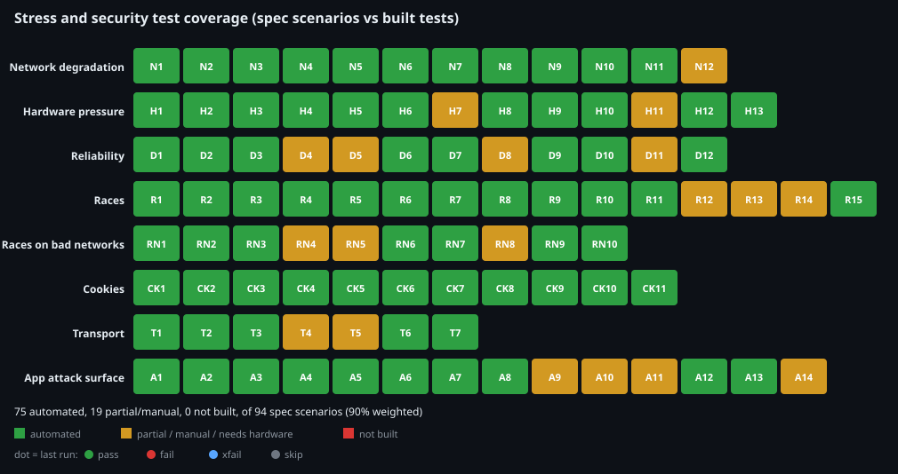
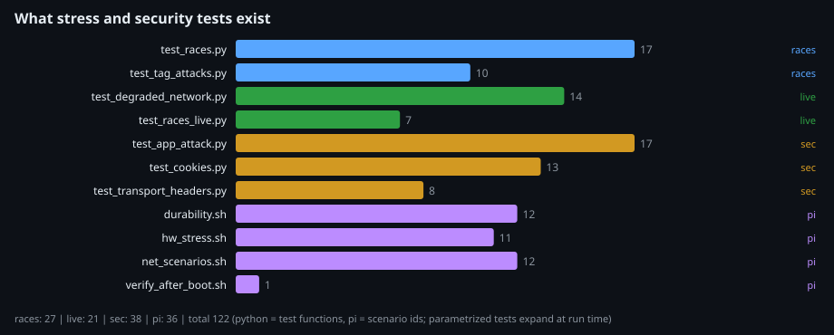

# CLARION official stress and security test

Reproduces the resilience and security results in the paper: network throttling (one side or both),
CPU / RAM / IO pressure, race conditions (including races caused by a bad network), cookie and
transport security, and crash / power-loss recovery on the Raspberry Pi 4 (Ubuntu 22.04, 2 GB).
Specification: [`docs/stress-and-security-test-protocol.md`](../../docs/stress-and-security-test-protocol.md).
Coverage of that specification: [`coverage.svg`](coverage.svg). Inventory of what exists: [`tests.svg`](tests.svg).





## Run it (one command)

```bash
python qa/stress/launch.py --list            # what each suite needs
python qa/stress/launch.py --suite races     # no setup: in-process race tests (about 40 s)
python qa/stress/launch.py --env qa/stress/stress.env      # everything that can run
sudo -E python3 qa/stress/launch.py --suite pi             # on the Pi: hardware / network / durability
```

`stress.env` is a `KEY=VALUE` file (git-ignored, never commit it):

```
BASE_URL=https://staging.example        # staging copy, never the live demo
ADMIN_EMAIL=...                         # also used as SEC_USER / SEC_PASS
ADMIN_PASSWORD=...
TOXIPROXY_URL=http://localhost:8474     # only for the degraded-network tests
```

A suite that cannot run is recorded as `skipped` with the reason, so a partial run is still a valid report.
Output goes to `qa/stress/results/<timestamp>/`: `report.html` (open this), `summary.json`, `results.svg`,
`latency.svg`, `resources.svg`, junit XML and one log per suite.

## Collect data from several machines

Run the Pi suite on the Pi, copy its `results/<ts>/` folder to your laptop, and merge everything:

```bash
python qa/stress/report.py results/laptop-run results/pi-run     # first folder receives the report
python qa/stress/report.py --coverage-only                       # just refresh coverage.svg
```

`report.py` picks up, recursively: junit `*.xml`, Pi `results.txt`, `*.probe.csv` (curl probe),
Locust `*_stats_history.csv`, and `collect.csv` (temperature, throttling, memory, swap, iowait).
Run `pi/collect.sh` alongside any manual test to feed the resource graph.

## Suites

| Suite | Folder | Needs | Covers |
|---|---|---|---|
| races | `backend/tests/test_races.py`, `test_tag_attacks.py` | nothing (SQLite; MariaDB via `DATABASE_URL` for R2) | R1-R15, A14 |
| live | `py/` | `BASE_URL`, admin login, Toxiproxy for RN | R live bursts, RN1-RN10 |
| sec | `sec/` | `BASE_URL`, `SEC_USER`/`SEC_PASS`, more per its README | CK1-CK11, T1-T7, A1-A13 |
| pi | `pi/` | Pi, root, Docker, `setup_pi.sh --apply` first | N1-N12, H1-H13, D1-D12 |

Destructive Pi steps (OOM, disk-full, power-cut, kernel panic, container kill) are off by default. They need
`--destructive`, and the worst ones `--i-know-this-kills`. Run them on a staging Pi with a verified backup.
Set `EMERGENCY_PATH` in the environment to the real emergency-scan path before the network and CPU scenarios.

## Reading the results

- **pass / fail**: the threshold from the spec (the paper's criteria) was met / missed.
- **xfail (blue)**: a known gap, written as a test that documents the finding. Today these are the
  non-atomic refresh-token rotation (R8), the login-lockout parallel bypass (R9, R9b), no generic
  `Idempotency-Key` (RN1b), lost-refresh-response recovery (RN2) and webhook age check (RN7c).
  An XPASS means the gap was fixed: delete its marker.
- **skip**: not runnable here (no `BASE_URL`, no endpoint to test, hardware needed).
- In `coverage.svg`, the cell colour is whether a test exists (green automated, amber partial/manual,
  red not built) and the dot is the last run's outcome.

## Limits to state in the paper

- Client round trip and server time are different numbers. The Pi probe only sees the client side; take
  server p95 from Caddy logs or `/metrics`.
- `netem` shapes this host's interface (the last mile), not Cloudflare's path.
- One load generator behind one IP shares one rate-limit bucket and cannot reach the DB-pool ceiling.
- NTAG213/215 offline reads have no tamper-proof counter; that residual risk is not testable in software.
- D8 (restore drill) needs a restic repository and the backup sandbox; D11 is a multi-day soak. Both are built but only run when you ask for them (`durability.sh D8 --destructive`, `durability.sh D11 --hours=168`).
